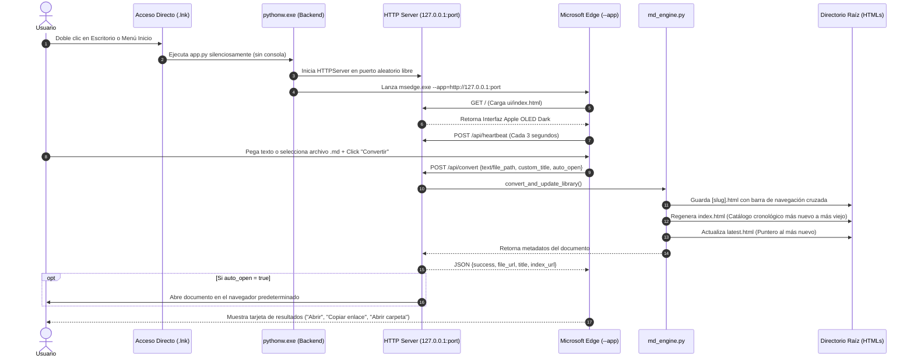

# Manual de Arquitectura y Especificación de Agentes: Markdown to HTML Desktop App

Este documento detalla la arquitectura técnica, estructura interna, ciclo de vida, especificación de API, motor de compilación, sistema de diseño e integración nativa en Windows de la aplicación de escritorio **Markdown to HTML**.

---

## 1. Visión General y Filosofía de Diseño

La aplicación fue concebida bajo las siguientes premisas fundamentales:

1. **Velocidad Extrema (< 20ms por documento):** El motor de compilación transforma cualquier documento Markdown complejo en HTML autónomo de manera casi instantánea, utilizando algoritmos de una sola pasada basados en expresiones regulares compiladas y la biblioteca estándar de Python.
2. **Cero Dependencias Externas (Zero-Bloatware):** No requiere frameworks pesados como Electron (que consumen >150 MB de RAM y cientos de megabytes en disco), ni entornos Node.js en ejecución, ni paquetes externos de `pip` (`tkinter`, `http.server`, `urllib`, `json`, `pathlib`, `re` son parte del runtime nativo de Python).
3. **Modo App Nativo de Windows:** La interfaz se renderiza utilizando la instancia del motor Chromium embebida en Microsoft Edge / Chrome mediante el switch `--app="http://127.0.0.1:port"`. Esto proporciona aceleración por hardware completa, renderizado de tipografía de ultra-alta definición, soporte para CSS moderno (`backdrop-filter: blur`, variables CSS, layout grid/flexbox) y ventana independiente sin barra de navegación ni pestañas.
4. **Apple Design System (WWDC HIG):** Interfaz en tema oscuro OLED (`#000000`), materiales de vidrio esmerilado translúcidos, respuesta física inmediata en pointer-down (`transform: scale(0.97)`), curvas de resorte naturales (`cubic-bezier(0.16, 1, 0.3, 1)`) y jerarquía tipográfica basada en el sistema San Francisco / system-ui.
5. **Autocontención y Portabilidad Total:** La carpeta de la aplicación no depende de rutas absolutas del sistema anfitrión. Todas las rutas se resuelven dinámicamente relativas al directorio de ejecución (`Path(__file__).resolve().parent`).

---

## 2. Estructura de Directorios y Archivos

```
MarkdownToHTML_App/
│
├── app.py                     # Servidor HTTP local, API REST y orquestador de ventana nativa
├── md_engine.py               # Motor autónomo de compilación Markdown a HTML Apple Design
├── config.json                # Configuración persistente (directorio raíz, auto-abrir, historial)
├── AGENTS.md                  # Especificación técnica exhaustiva para agentes y desarrolladores
├── README.md                  # Guía de usuario y portabilidad para humanos
├── run_tests.py               # Ejecutor maestro de suite integral (79 tests unitarios/API/seguridad)
├── verify_app.py              # Suite de pruebas de humo rápidas (9 checks automatizados)
├── run.bat                    # Lanzador rápido por lotes de Windows (1 clic)
├── launch.vbs                 # Lanzador secundario silencioso en VBScript
├── install_shortcuts.ps1      # Generador de accesos directos con icono en Escritorio y Menú Inicio
│
├── tests/                     # Suite exhaustiva modular (unittest nativo, zero-bloatware)
│   ├── __init__.py            # Inicializador de paquete de pruebas
│   ├── test_helpers.py        # Clases base aisladas en carpetas temporales y mocks
│   ├── test_md_engine.py      # 42 tests: AST, llamadas, tablas, kbd, listas anidadas, slugify
│   ├── test_app_api.py        # 19 tests: Endpoints REST GET/POST, headers, loopback real
│   ├── test_window_geometry.py# 7 tests: Dimensiones responsivas de pantalla escritorio vs laptop
│   ├── test_config_and_history.py # 6 tests: Configuración, límite de 10 ítems y purga de fantasmas
│   └── test_security.py       # 5 tests: Traversal defense en /assets/, protección y XSS
│
├── ui/
│   └── index.html             # Interfaz gráfica SPA en Apple OLED Dark (HTML5/CSS3/Vanilla JS)
│
└── assets/
    ├── app_icon.ico           # Icono multi-resolución en formato nativo Windows ICO (256x256)
    ├── app_icon.png           # Isotipo del icono en formato PNG de alta resolución
    └── generate_icon.ps1      # Generador vectorial del icono utilizando System.Drawing
```

---

## 3. Diagrama Arquitectónico y Flujo de Datos



---

## 4. Especificación del Motor de Compilación (`md_engine.py`)

El módulo `md_engine.py` es completamente autónomo y no depende del servidor web para funcionar (puede usarse también por línea de comandos o importarse como biblioteca en otros scripts).

### 4.1. Analizador Léxico y Sintáctico de Markdown

El parser implementa un compilador de un solo paso que procesa el documento línea por línea:

1. **Frontmatter YAML:**
   - Detecta delimitadores iniciales `---` al comienzo del documento.
   - Extrae pares clave-valor (`title`, `name`, etc.) para nombrar automáticamente el documento.
2. **Encabezados (`H1` a `H6`):**
   - El primer `# Encabezado 1` encontrado se adopta como título del documento si no se especificó un título custom o YAML frontmatter.
   - Se asignan slugs sanitizados mediante `slugify()` a cada encabezado para habilitar anclajes intra-documento (`#slug`).
3. **Alertas / Callouts Estilo GitHub & Apple HIG:**
   - Reconoce la sintaxis `> [!NOTE]`, `> [!TIP]`, `> [!IMPORTANT]`, `> [!WARNING]`, `> [!CAUTION]`.
   - Genera contenedores con bordes temáticos diferenciados e inyecta iconos vectoriales SVG nativos sin peticiones de red.
4. **Bloques de Código y Sintaxis:**
   - Bloques delimitados por triple tilde invertida ```lang.
   - Cabecera con nombre del lenguaje en mayúsculas y botón táctil **"Copiar"** con feedback en tiempo real.
   - Resaltado sintáctico offline para palabras clave de `Python`, `JavaScript`, `JSON`, `PowerShell`, `Groovy`, `Gherkin` y bloques `diff` (líneas verdes `+` y rojas `-`).
5. **Tablas Responsivas:**
   - Detecta filas delimitadas por barras verticales `|` y separadores de alineación (`:---`, `:---:`, `---:`).
   - Envuelve la tabla en un contenedor `.table-container` con `overflow-x: auto` y sombreado zebra striping.
6. **Listas Jerárquicas y Anidadas (List Hierarchy & Sublists):**
   - Soporte nativo para listas ordenadas (`1.`, `2.`, `\d+.` con atributo `start` si el primer número es distinto de 1).
   - Soporte para listas no ordenadas (`-`, `*`, `+`) y listas de tareas (`- [ ]`, `- [x]`).
   - Algoritmo de árbol basado en pila que detecta sangría relativa (2, 3 o 4 espacios / tabulaciones) y anida semánticamente las sublistas dentro del `<li>` padre.
   - Sangría visual a la derecha (`padding-left: 1.7rem` en base y `1.5rem` adicional en cada subnivel) y marcadores jerárquicos de viñetas (`disc` -> `circle` -> `square`) y numeración (`decimal` -> `lower-alpha` -> `lower-roman`).
   - Respeto a líneas de continuación sangradas dentro de un mismo elemento de lista.
7. **Formateo en Línea (Inline) y Anclajes:**
   - Código en línea `` `código` `` (protegido con tokens antes de parsear estilos de texto para evitar colisiones).
   - Atajos de teclado `[[kbd:Ctrl+C]]` -> `<kbd>Ctrl+C</kbd>`.
   - Negrita `**` o `__`, cursiva `*` o `_`, tachado `~~`.
   - Enlaces intra-documento `[texto](#ancla)`: vinculados directamente con slugify al ID del encabezado sin recargar ni abrir nueva pestaña (`target="_self"` implícito).
   - Enlaces externos `[texto](url)` con apertura segura (`target="_blank" rel="noopener noreferrer"`).
   - Imágenes `` estilizadas con radios concéntricos.
   - Badges de estado automáticos: `[PASS]`, `[FAIL]`, `[WARN]`, `[INFO]`, `[OK]`, `[ERROR]`.

### 4.2. Barra de Navegación Cruzada (Cross-Document Navigation Bar)

En cada archivo HTML generado, `md_engine.py` inyecta una barra flotante en la cabecera:

```html
<nav class="top-nav-bar" aria-label="Navegación de biblioteca">
  <div class="nav-links-group">
    <a href="./index.html" class="nav-pill-btn" title="Ir al catálogo de todos los archivos generados">
      <!-- Icono SVG Carpeta -->
      <span>Índice de Documentos</span>
    </a>
    <a href="./latest.html" class="nav-pill-btn" title="Ir a la página más nueva creada">
      <!-- Icono SVG Rayo -->
      <span>Más Reciente</span>
    </a>
  </div>
  <button class="theme-toggle-btn" id="theme-btn" onclick="toggleTheme()" title="Alternar tema claro/oscuro">
    <!-- Iconos Sol/Luna -->
    <span>Tema</span>
  </button>
</nav>
```

Esta barra permite que el usuario navegue bidireccionalmente entre el documento actual, la biblioteca completa y el documento más nuevo sin necesidad de abrir el Explorador de archivos ni la app de escritorio.

### 4.3. Catálogo Cronológico Dinámico (`index.html`)

La función `generate_index_html(root_dir: Path)`:
1. Escanea el directorio raíz en busca de todos los archivos `*.html` (excluyendo `index.html` y `latest.html`).
2. Lee los primeros 4000 bytes de cada archivo para extraer el `<title>` original del documento.
3. Obtiene el timestamp de modificación del sistema de archivos (`st_mtime`) y el tamaño en kilobytes.
4. **Ordena los documentos de forma estrictamente descendente** (el documento más reciente aparece siempre en la primera posición).
5. Renderiza una página de biblioteca Apple OLED Dark con:
   - Contador de documentos en vivo.
   - Buscador instantáneo en el cliente (filtra por título o nombre de archivo mientras el usuario escribe).
   - Tarjetas de documento con botón directo **"Abrir Documento"** y **"Copiar Enlace"**.
   - Enlace destacado en la barra superior al documento más nuevo.

### 4.4. Redireccionador al Más Reciente (`latest.html`)

La función `generate_latest_redirect(root_dir, newest_file, doc_title)`:
- Crea un archivo `latest.html` con una cabecera `<meta http-equiv="refresh" content="0; url=./{newest_filename}">`.
- Incluye una tarjeta de respaldo con botón manual por si los meta-refresh automáticos estuvieran restringidos en el navegador.

---

## 5. Especificación del Servidor Backend (`app.py`)

El archivo `app.py` orquesta el servicio HTTP local y la integración con el sistema operativo Windows.

### 5.1. Manejo del Ciclo de Vida y Watchdog Defensivo

Para evitar que procesos huérfanos de Python se queden ejecutándose indefinidamente en memoria cuando el usuario cierra la ventana de la aplicación:

```python
client_connected = False

def watchdog_thread(server: HTTPServer):
    global last_heartbeat, client_connected
    start_time = time.time()
    # 1. Espera hasta 120 segundos para la primera conexión del navegador
    while not client_connected:
        time.sleep(1)
        if time.time() - start_time > 120:
            server.shutdown()
            return

    # 2. Una vez conectado, si pasan más de 30 segundos sin ningún latido o petición, apagar
    while True:
        time.sleep(3)
        if time.time() - last_heartbeat > 30:
            server.shutdown()
            break
```

**Regla de Seguridad:**
- Cada petición (`do_GET`, `do_POST` y en particular `POST /api/heartbeat`) actualiza `last_heartbeat = time.time()` y activa `client_connected = True`.
- La interfaz envía un latido inmediato al cargar y posteriormente un `setInterval` cada 3 segundos.
- Si el usuario cierra la ventana de la app, el navegador interrumpe los latidos; tras 30 segundos de silencio, el servidor realiza un `server.shutdown()` limpio y el proceso `pythonw.exe` finaliza.

### 5.2. Compatibilidad con `pythonw.exe`

En Windows, al ejecutar scripts mediante `pythonw.exe` (modo ventana sin consola gráfica):
- `sys.stdout` y `sys.stderr` son evaluados como `None`.
- **Patrón Obligatorio:** Cualquier acceso a `sys.stdout` debe verificar su existencia antes de consultar atributos:
  ```python
  if sys.stdout and getattr(sys.stdout, 'encoding', None):
      try:
          if sys.stdout.encoding.lower() != 'utf-8':
              sys.stdout.reconfigure(encoding='utf-8', errors='replace')
      except Exception:
          pass
  ```

### 5.3. Catálogo Completo de Endpoints de la API

| Endpoint | Método | Descripción | Parámetros de Entrada (JSON) | Respuesta Exitosa (JSON) |
| :--- | :---: | :--- | :--- | :--- |
| `/` | `GET` | Sirve la interfaz gráfica SPA | Ninguno | Documento HTML (`ui/index.html`) |
| `/assets/<file>` | `GET` | Sirve iconos e imágenes estáticas | Ruta relativa en URL | Binario (`image/png`, etc.) |
| `/api/config` | `GET` | Obtiene la configuración actual | Ninguno | `{ root_dir, auto_open, recent_conversions }` |
| `/api/config` | `POST` | Actualiza la configuración persistente | `{ root_dir?: string, auto_open?: bool }` | Objeto `config` actualizado |
| `/api/convert` | `POST` | Compila Markdown y actualiza la biblioteca | `{ text?: string, file_path?: string, custom_title?: string, auto_open?: bool }` | `{ success, file_path, file_url, filename, title, index_url, latest_url, words, reading_time }` |
| `/api/browse-folder`| `POST` | Abre el selector de carpetas nativo de Windows | Ninguno | `{ chosen_path: string \| null }` |
| `/api/browse-file` | `POST` | Abre el selector de archivos `.md` nativo de Windows | Ninguno | `{ file_path: string \| null, filename: string \| null }` |
| `/api/open-file` | `POST` | Abre una URL o archivo en el navegador predeterminado | `{ url: string }` | `{ status: "opened" }` |
| `/api/open-folder`| `POST` | Abre el Explorador de Windows en la carpeta raíz | Ninguno | `{ status: "opened" }` |
| `/api/open-index` | `POST` | Abre `index.html` en el navegador del sistema | Ninguno | `{ status: "opened", url: string }` |
| `/api/delete-document` | `POST` | Elimina un documento HTML de la biblioteca y del historial | `{ filename?: string, file_path?: string }` | `{ success: bool, filename: string, recent_conversions: array }` |
| `/api/adjust-window` | `POST` | Ajusta y centra nativamente el tamaño de la ventana según la resolución de la pantalla | `{ screen_w?: number, screen_h?: number }` | `{ success: bool, target_w, target_h, pos_x, pos_y }` |
| `/api/heartbeat` | `POST` | Refresca el temporizador del watchdog | Ninguno | `{ status: "alive" }` |

### 5.4. Dimensionamiento Dinámico Adaptativo y Control Nativo de Ventana

La aplicación detecta dinámicamente la resolución y escala de la pantalla activa mediante `user32.GetSystemMetrics` y `SetProcessDpiAwareness`:

1. **Monitor Grande de Escritorio ($\ge 1600\text{px}$, ej. 1920x1080, 2K, 4K):**
   - Inicia con dimensiones compactas (`750x680px`), centrada en pantalla para facilitar el trabajo lado a lado con editores de código o navegadores.
2. **Laptop o Pantalla Mediana/Pequeña ($< 1600\text{px}$, ej. 1366x768, 1280x720, 1536x864):**
   - Inicia con tamaño amplio y cómodo (`85%` del ancho y `86%` del alto disponible), garantizando lectura fluida sin solaparse con la barra de tareas.
3. **Control Nativo Win32 contra Cache de Estado Maximizado:**
   - Para prevenir que Microsoft Edge recuerde un estado maximizado previo, un hilo en segundo plano localiza la ventana de la app (`find_and_adjust_app_window`), invoca `ShowWindow(hwnd, SW_RESTORE)` y aplica las coordenadas exactas con `SetWindowPos`.
   - La interfaz cliente (`ui/index.html`) reporta sus métricas reales vía `POST /api/adjust-window` al inicializar para sincronizar entornos multimonitor.

---

## 6. Interfaz de Usuario y Sistema de Diseño (`ui/index.html`)

La interfaz está construida con HTML5 semántico y CSS Vanilla puro sin librerías externas.

### 6.1. Tokens de Color y Superficies

```css
:root {
  --canvas: #000000;                       /* Negro OLED profundo */
  --card: #141416;                         /* Superficie principal */
  --card-alt: #1a1a1e;                     /* Superficie elevada */
  --card-hover: #202025;                   /* Hover sutil */
  --border: rgba(255, 255, 255, 0.08);     /* Borde reflectante */
  --border-focus: #2997ff;                 /* Azul Apple interactivo */
  --text: #f5f5f7;                         /* Texto principal de alto contraste */
  --text-muted: #a1a1a6;                   /* Metadatos y etiquetas secundarias */
  --text-faint: #6e6e73;                   /* Texto terciario */
  --primary: #2997ff;                      /* Acento Apple WWDC */
  --primary-hover: #47a7ff;                /* Acento iluminado */
  --primary-surface: rgba(41, 151, 255, 0.12); /* Vidrio tintado */
  --success: #30d158;                      /* Verde Apple para confirmaciones */
  --spring: cubic-bezier(0.16, 1, 0.3, 1); /* Física de resorte Apple */
}
```

### 6.2. Componentes Clave

1. **Cabecera de Marca con Indicador de Estado:**
   - Logotipo con radio de curvatura squircle de 7px.
   - Píldora de estado con luz verde palpitante y texto *"Motor Activo"*.
2. **Panel de Ajustes de Carpeta Raíz:**
   - Muestra la ruta actual truncada limpiamente con tipografía monospace.
   - Botones compactos: `[ 📂 Cambiar Carpeta ]` (abre diálogo de Windows) y `[ ↗️ Abrir en Explorador ]`.
   - Switch estilo iOS para activar o desactivar la apertura automática en el navegador al compilar.
   - Acceso directo rápido: `[ 📚 Ver Catálogo Completo (Índice) → ]`.
3. **Pestañas Duales de Entrada:**
   - **Pestaña 1 (Pegar Markdown):** Área de texto con scroll suave, contador dinámico en tiempo real de caracteres y palabras, botón directo de pegar desde el portapapeles y botón de limpiar.
   - **Pestaña 2 (Archivo .md):** Zona de arrastrar y soltar (Drag & Drop) con soporte para eventos `dragover` / `drop` y lectura inmediata vía `FileReader`, además de botón para examinar mediante el explorador del sistema.
4. **Botón Principal de Conversión:**
   - Gradiente azul Apple con resplandor exterior (`box-shadow: 0 4px 14px rgba(0, 113, 227, 0.4)`).
   - Atajo de teclado global: `Ctrl + Enter` (o `Cmd + Enter`) compila inmediatamente sin usar el ratón.
5. **Tarjeta de Resultados Fluida:**
   - Oculta por defecto; se materializa con animación física de resorte tras la compilación.
   - Muestra nombre del archivo, badge de tiempo de procesamiento (`< 20ms`), botones de acción: `[ 🌐 Abrir en Navegador ]`, `[ 📋 Copiar Enlace ]` (con feedback táctil *"✓ Copiado"*), `[ 📁 Abrir Carpeta ]` y `[ 📚 Ver Índice ]`.
6. **Historial de Conversiones Recientes:**
   - Renderiza las últimas 10 conversiones persistidas en `config.json` con acceso en 1 clic para abrir o copiar.

---

## 7. Creación y Mantenimiento de Accesos Directos en Windows

### 7.1. Arquitectura del Acceso Directo `.lnk`

El script [install_shortcuts.ps1](file:///c:/General/MarkdownToHTML_App/install_shortcuts.ps1) utiliza la interfaz COM `WScript.Shell` para registrar los accesos directos en el sistema operativo:

- **Ruta en Escritorio:** `[Environment]::GetFolderPath('Desktop')\Markdown to HTML.lnk`
- **Ruta en Menú Inicio:** `[Environment]::GetFolderPath('Programs')\Markdown to HTML.lnk`

**Propiedades Configuradas en el Acceso Directo:**
- `TargetPath`: Ruta absoluta al binario `pythonw.exe`.
- `Arguments`: `"app.py"` (usar únicamente el nombre del archivo evita conflictos con espacios en rutas largas de Windows).
- `WorkingDirectory`: Directorio donde reside `app.py`.
- `IconLocation`: Ruta al archivo `assets\app_icon.ico,0`.

Al hacer doble clic en el acceso directo, Windows invoca `pythonw.exe` en el directorio de la aplicación, ejecutando el servidor en segundo plano e instanciando la ventana de Edge inmediatamente sin ventanas negras de CMD.

---

## 8. Arquitectura y Procedimiento de Pruebas Automatizadas

La aplicación cuenta con dos niveles de validación automatizada:

### 8.1. Suite Integral Exhaustiva (`run_tests.py` - 82 Tests)

Para ejecutar la verificación completa de toda la base de código con aislamiento total de disco:

```powershell
python "c:\General\MarkdownToHTML_App\run_tests.py"
```

La suite modular utiliza exclusivamente la biblioteca estándar `unittest` (Zero-Bloatware) y se divide en 5 módulos especializados en `tests/`:

1. **`tests/test_md_engine.py` (42 tests):**
   - Generación y sanitización de slugs (`slugify`) con caracteres Unicode, acentos y emojis.
   - Limpieza de títulos en línea (`clean_markdown_inline`) de HTML, imágenes, enlaces y atajos.
   - Detección inteligente y jerárquica de títulos (`detect_smart_title`) por H1, Setext, H2, H3, Frontmatter YAML, negritas o primera línea.
   - Badges de estado Apple HIG (`[PASS]`, `[FAIL]`, `[WARN]`, `[INFO]`).
   - Atajos de teclado físicos (`[[kbd:Ctrl+C]]` -> `<kbd>Ctrl+C</kbd>`).
   - Formateo en línea, anclajes intra-documento e hipervínculos externos seguros.
   - Resaltado sintáctico de código para Python, JavaScript, PowerShell y diffs (+/-).
   - Contenedores de alertas GitHub/Apple con inyección de SVG nativos.
   - Tablas responsivas con detección y alineación de columnas (`:---`, `:---:`, `---:`).
   - Jerarquía multinivel de listas anidadas y checklists interactivos.
   - Integración de catálogo cronológico (`index.html`) y puntero (`latest.html`).
2. **`tests/test_app_api.py` (19 tests):**
   - Servidor HTTP en loopback real sobre puerto efímero.
   - Servicio de SPA `ui/index.html` y cabeceras MIME.
   - Entrega de recursos estáticos (`/assets/`) y manejo de códigos 404.
   - Endpoints `/api/config` (GET y POST), persistencia y validación de rutas.
   - Endpoint `/api/heartbeat` y control del watchdog.
   - Endpoint `/api/convert` desde texto directo o archivos físicos.
   - Endpoint `/api/delete-document` con regeneración de índice y catálogo.
   - Endpoints de orquestación del sistema (`/api/open-file`, `/api/open-folder`, `/api/open-index`, `/api/browse-folder`, `/api/browse-file`).
3. **`tests/test_window_geometry.py` (7 tests):**
   - Dimensionamiento responsivo para monitores grandes ($\ge 1600\text{px}$, 1080p, 2K, 4K) en tamaño compacto de 750px de ancho.
   - Dimensionamiento adaptativo para laptops ($< 1600\text{px}$) con 85% de ancho y 86% de alto.
   - Centrado matemático en pantalla y límites mínimos de seguridad (680x560px).
   - Resiliencia ante valores nulos, cadenas no numéricas o coordenadas negativas.
4. **`tests/test_config_and_history.py` (9 tests):**
   - Creación automática de archivo `config.json` con valores por defecto.
   - Recuperación automática defensiva ante archivos de configuración corruptos.
   - Deduplicación de historial y reordenamiento del documento más reciente al frente.
   - Límite estricto de los últimos 10 documentos convertidos.
   - Depuración automática de documentos fantasma que hayan sido borrados manualmente fuera de la aplicación.
   - Auto-recarga y descubrimiento de documentos HTML preexistentes en la carpeta raíz con extracción de título y fecha real.
   - Exclusión garantizada de `index.html` y `latest.html` del historial de convertidos.
   - Fusión limpia sin duplicados de archivos untracked con historial existente.
5. **`tests/test_security.py` (5 tests):**
   - Prevención de Path Traversal en `/assets/` (bloqueo de accesos relativos `../`).
   - Bloqueo de eliminación de archivos ajenos o protegidos (`index.html`, `latest.html`, `.txt`, `.py`).
   - Sanitización contra inyección XSS de etiquetas `<script>` en bloques de código y código en línea.

### 8.2. Suite de Verificación Rápida de Humo (`verify_app.py` - 9 Checks)

Diseñada para chequeos rápidos de humo en entornos de despliegue o antes de empaquetar:

```powershell
python "c:\General\MarkdownToHTML_App\verify_app.py"
# O para encadenar la suite completa:
python "c:\General\MarkdownToHTML_App\verify_app.py" --full
```

---

## 9. Guía de Portabilidad y Migración a Nuevos Equipos

Si se desea mover la aplicación a otra computadora con Windows o clonarla en un nuevo repositorio:

1. **Copiar la carpeta completa:** Copiar `MarkdownToHTML_App` a la ubicación preferida (ej. `C:\Herramientas\MarkdownToHTML_App` o el directorio personal).
2. **Generar los accesos directos:** Abrir PowerShell en esa carpeta y ejecutar:
   ```powershell
   powershell -ExecutionPolicy Bypass -File .\install_shortcuts.ps1
   ```
3. El script detectará automáticamente la instalación de Python de la nueva máquina, compilará el icono y dejará los accesos directos listos para usar en el Escritorio y el Menú Inicio.

---

## 10. Estándar de Flujo de Trabajo Git Flow y Conventional Commits

El desarrollo y mantenimiento continuo de la aplicación se rige por el protocolo formal detallado en [GIT_FLOW.md](file:///c:/General/MarkdownToHTML_App/GIT_FLOW.md) y la regla [.agents/rules/git_flow.md](file:///c:/General/MarkdownToHTML_App/.agents/rules/git_flow.md):

1. **Ramas Principales:** `master` (producción y tags SemVer) y `develop` (integración continua).
2. **Ramas de Trabajo:** `feature/*`, `bugfix/*`, `release/*`, `hotfix/*`, `test/*`.
3. **Conventional Commits:** `<tipo>(<alcance>): <descripción>` con tipos estandarizados (`feat`, `fix`, `docs`, `style`, `refactor`, `perf`, `test`, `chore`, `merge`).
4. **Ciclo de Desarrollo Obligatorio (7 Pasos):** Inspección limpia -> Creación de rama de trabajo -> TDD y Zero-Bloatware -> Validación completa con 100% de éxito en tests -> Commits semánticos atómicos -> Integración `merge --no-ff` a `develop` -> Limpieza de rama integrada.

