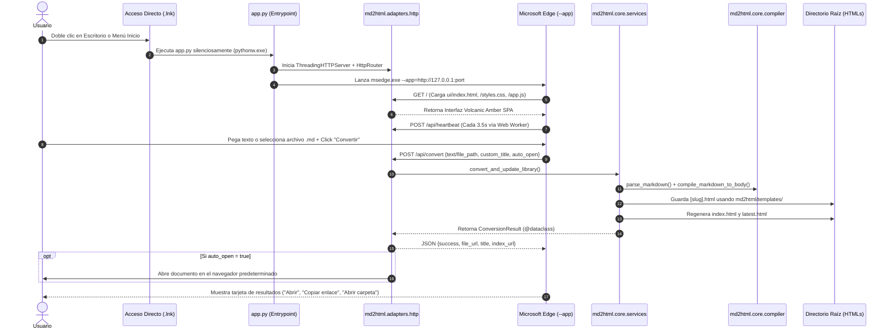

# Manual de Arquitectura y Especificación de Agentes: Markdown to HTML Desktop App

Este documento detalla la arquitectura técnica Hexagonal (Puertos y Adaptadores), estructura interna, ciclo de vida, especificación de API, motor de compilación, sistema de diseño e integración nativa en Windows de la aplicación de escritorio **Markdown to HTML**.

---

## 1. Visión General y Filosofía de Diseño

La aplicación fue concebida bajo las siguientes premisas fundamentales:

1. **Velocidad Extrema (< 20ms por documento):** El motor de compilación transforma cualquier documento Markdown complejo en HTML autónomo de manera casi instantánea, utilizando algoritmos de una sola pasada basados en expresiones regulares compiladas y la biblioteca estándar de Python.
2. **Cero Dependencias Externas (Zero-Bloatware):** No requiere frameworks pesados como Electron (que consumen >150 MB de RAM y cientos de megabytes en disco), ni entornos Node.js en ejecución, ni paquetes externos de `pip` (`dataclasses`, `typing`, `tkinter`, `http.server`, `urllib`, `json`, `pathlib`, `re`, `ctypes` son parte del runtime nativo de Python).
3. **Arquitectura Hexagonal Pragmática (Ports & Adapters):** El código fuente está estructurado en el paquete modular `md2html/` con separación estricta entre el núcleo de dominio (`md2html/core/`), los adaptadores de infraestructura (`md2html/adapters/` para HTTP, almacenamiento JSON/caché y APIs nativas Win32) y las plantillas desacopladas (`md2html/templates/`), manteniendo puntos de entrada ligeros (< 100 líneas) en la raíz por compatibilidad.
4. **Modo App Nativo de Windows:** La interfaz se renderiza utilizando la instancia del motor Chromium embebida en Microsoft Edge / Chrome mediante el switch `--app="http://127.0.0.1:port"`. Esto proporciona aceleración por hardware completa, renderizado de tipografía de ultra-alta definición, soporte para CSS moderno (`backdrop-filter: blur`, variables CSS, layout grid/flexbox) y ventana independiente sin barra de navegación ni pestañas.
5. **Estilo Ámbar Volcánico y Negro Obsidiana (Volcanic Amber & Deep Obsidian):** Interfaz en tema negro obsidiana mate puro (`#070708`), tarjetas en superficie basalto mate (`#111114`), elevación mate (`#17181c`), acentos en ámbar volcánico eléctrico mate (`#f97316`), texto en blanco slate anti-fatiga (`#f8fafc`) y ceniza basalto (`#94a3b8`), materiales translúcidos ahumados con blur, respuesta táctil inmediata en pointer-down (`transform: scale(0.97)`), curvas de resorte naturales (`cubic-bezier(0.16, 1, 0.3, 1)`) y jerarquía tipográfica limpia.
6. **Autocontención y Portabilidad Total:** La carpeta de la aplicación no depende de rutas absolutas del sistema anfitrión. Todas las rutas se resuelven dinámicamente relativas al directorio de ejecución (`Path(__file__).resolve().parent`).

---

## 2. Estructura de Directorios y Archivos (Arquitectura Hexagonal)

```
MarkdownToHTML_App/
│
├── app.py                     # Punto de entrada y fachada retrocompatible del servidor HTTP y ciclo de vida
├── md_engine.py               # Punto de entrada CLI y fachada retrocompatible del motor de compilación
├── math_engine.py             # Fachada retrocompatible del módulo matemático LaTeX
├── tray_manager.py            # Fachada retrocompatible del administrador del System Tray
│
├── md2html/                   # Paquete principal (Arquitectura Hexagonal: Puertos y Adaptadores)
│   ├── __init__.py
│   ├── core/                  # CAPA DE DOMINIO Y APLICACIÓN (100% agnóstica de HTTP y Win32)
│   │   ├── models.py          # Entidades tipadas (@dataclass): ParsedDocument, ConversionResult, WindowGeometry
│   │   ├── ports.py           # Contratos de puertos (typing.Protocol): Config, Cache, Window, Clipboard, Dialog
│   │   ├── compiler/          # Motor de compilación Markdown -> AST -> HTML
│   │   │   ├── ast_nodes.py       # Nodos AST jerárquicos para listas anidadas y checklists
│   │   │   ├── inline_parser.py   # Slugs, badges, atajos kbd, enlaces, código inline y resaltado sintáctico
│   │   │   ├── markdown_parser.py # Analizador léxico/sintáctico de bloques, tablas, alertas y Mermaid
│   │   │   ├── math_protector.py  # Tokenización defensiva LaTeX y ensamblaje MathJax 3 SVG offline
│   │   │   └── title_detector.py  # Detección jerárquica de títulos (Frontmatter, H1-H6 fuera de código, Setext, negrita)
│   │   └── services/          # Casos de uso de aplicación
│   │       ├── catalog_service.py    # Generación de index.html, latest.html y eliminación segura
│   │       ├── conversion_service.py # Orquestación de compilación y actualización de biblioteca
│   │       └── lifecycle_service.py  # Estado encapsulado (AppLifecycleState) y bucle del watchdog
│   │
│   ├── adapters/              # CAPA DE INFRAESTRUCTURA Y ADAPTADORES
│   │   ├── http/              # Adaptador primario REST HTTP
│   │   │   ├── router.py          # Enrutador declarativo GET/POST libre de cadenas if/elif
│   │   │   └── handlers.py        # Controlador HTTP (AppRequestHandler)
│   │   ├── storage/           # Adaptadores secundarios de persistencia en disco
│   │   │   ├── config_repo.py     # Repositorio JSON (config.json, historial y purga de fantasmas)
│   │   │   ├── index_cache.py     # Caché inteligente .index_cache.json contra bloqueos de antivirus
│   │   │   └── logger.py          # Registro defensivo de diagnósticos (debug_log.txt)
│   │   └── os_win32/          # Adaptadores secundarios del Sistema Operativo Windows (ctypes/Win32)
│   │       ├── browser_launcher.py# Descubrimiento de Edge/Chrome, puertos y lanzamiento en modo --app
│   │       ├── clipboard.py       # Lectura directa de portapapeles Win32 (CF_UNICODETEXT, cero avisos)
│   │       ├── dialogs.py         # Selectores nativos de archivos y carpetas (tkinter oculto)
│   │       ├── mutex.py           # Guardián de instancia única mediante Named Mutex de kernel
│   │       ├── system_tray.py     # Bandeja del sistema nativa (Shell_NotifyIconW y bucle Win32)
│   │       └── window_manager.py  # Geometría adaptativa, DPI awareness y rastreo HWND (IsWindow)
│   │
│   └── templates/             # CAPA DE RECURSOS Y PLANTILLAS DE DOCUMENTOS COMPILADOS
│       ├── icons.py           # Catálogo de iconos vectoriales SVG (alertas y barra de navegación)
│       ├── loader.py          # Cargador con caché en memoria RAM para plantillas y runtimes offline
│       ├── html/              # Plantillas estructurales HTML (document.html, catalog.html, latest_redirect.html)
│       ├── styles/            # Hojas de estilo modulares (document.css, math.css, catalog.css)
│       └── scripts/           # Controladores JS cliente (mermaid_client.js)
│
├── ui/                        # Interfaz gráfica SPA modularizada (Volcanic Amber & Deep Obsidian)
│   ├── index.html             # Estructura semántica HTML5
│   ├── styles.css             # Sistema de diseño CSS3 y tokens Volcanic Amber
│   └── app.js                 # Lógica reactiva cliente, Web Worker de latidos y comunicación API
│
├── tests/                     # Suite exhaustiva modular (140 tests con unittest nativo, zero-bloatware)
│   ├── __init__.py            # Inicializador de paquete de pruebas
│   ├── test_helpers.py        # Clases base aisladas en carpetas temporales y mocks
│   ├── test_md_engine.py      # 68 tests: AST, llamadas, tablas, kbd, listas anidadas, slugify, mermaid, latex math, caché
│   ├── test_app_api.py        # 27 tests: Endpoints REST GET/POST, router, modelos, assets, UI modular, tray y portapapeles
│   ├── test_tray_manager.py   # 6 tests: Estructuras Win32, ciclo de vida del hilo, menús, callbacks y globo
│   ├── test_window_geometry.py# 7 tests: Dimensiones responsivas de pantalla escritorio vs laptop
│   ├── test_config_and_history.py # 9 tests: Configuración, límite de 10 ítems, purga de fantasmas y recarga selectiva
│   ├── test_installer_and_distribution.py # 15 tests: Integridad del instalador, accesos directos y portabilidad
│   └── test_security.py       # 5 tests: Traversal defense en /assets/, protección y XSS
│
├── assets/
│   ├── app_icon.ico           # Icono multi-resolución en formato nativo Windows ICO (256x256)
│   ├── app_icon.png           # Isotipo del icono en formato PNG de alta resolución
│   ├── generate_icon.ps1      # Generador vectorial del icono utilizando System.Drawing
│   ├── mermaid.min.js         # Runtime minificado de diagramas Mermaid 11.x (100% offline)
│   └── tex-svg.min.js         # Runtime vectorial SVG de fórmulas matemáticas MathJax 3 (100% offline)
│
├── config.template.json       # Plantilla limpia rastreada en Git para inicialización
├── config.json                # Configuración persistente local (en .gitignore, aislada de Git)
├── run_tests.py               # Ejecutor maestro de suite integral (140 tests)
├── verify_app.py              # Suite de pruebas de humo rápidas (10 checks automatizados)
├── run.bat                    # Lanzador rápido por lotes de Windows (1 clic)
├── launch.vbs                 # Lanzador secundario silencioso en VBScript
├── instalar.bat               # Instalador nativo universal de 1 clic para Windows (%LOCALAPPDATA%)
├── desinstalar.bat            # Desinstalador limpio de accesos directos y carpeta de programa
└── install_shortcuts.ps1      # Generador/eliminador de accesos directos con icono en Escritorio y Menú Inicio
```

---

## 3. Diagrama Arquitectónico y Flujo de Datos



---

## 4. Especificación del Motor de Compilación (`md2html/core/compiler/` y `md_engine.py`)

El motor de compilación reside en `md2html/core/compiler/` y los servicios de biblioteca en `md2html/core/services/`, expuestos también a través de la fachada `md_engine.py` para ejecución directa por línea de comandos o importación externa.

### 4.1. Analizador Léxico y Sintáctico de Markdown

El parser implementa un compilador de un solo paso que procesa el documento línea por línea:

1. **Frontmatter YAML (`title_detector.py`):**
   - Detecta delimitadores iniciales `---` al comienzo del documento.
   - Extrae pares clave-valor (`title`, `name`, etc.) para nombrar automáticamente el documento.
2. **Encabezados (`H1` a `H6`):**
   - El primer `# Encabezado 1` encontrado fuera de bloques de código se adopta como título del documento si no se especificó un título custom o YAML frontmatter. Si no existe H1, se evalúan H2 a H6 legítimos fuera de código. Cualquier línea o comentario `# ...` dentro de bloques cercados (``` o ~~~) es estrictamente ignorado. En caso de no existir ningún encabezado fuera de código, se recurre a la línea en negrita o primeras palabras del texto.
   - Se asignan slugs sanitizados mediante `slugify()` a cada encabezado para habilitar anclajes intra-documento (`#slug`).
3. **Alertas / Callouts Estilo GitHub & Apple HIG (`markdown_parser.py` + `templates/icons.py`):**
   - Reconoce la sintaxis `> [!NOTE]`, `> [!TIP]`, `> [!IMPORTANT]`, `> [!WARNING]`, `> [!CAUTION]`.
   - Genera contenedores con bordes temáticos diferenciados e inyecta iconos vectoriales SVG nativos sin peticiones de red.
4. **Bloques de Código y Sintaxis (`inline_parser.py`):**
   - Bloques delimitados por triple tilde invertida ```lang.
   - Cabecera con nombre del lenguaje en mayúsculas y botón táctil **"Copiar"** con feedback en tiempo real.
   - Resaltado sintáctico offline para palabras clave de `Python`, `JavaScript`, `JSON`, `PowerShell`, `Groovy`, `Gherkin` y bloques `diff` (líneas verdes `+` y rojas `-`).
5. **Tablas Responsivas (`markdown_parser.py`):**
   - Detecta filas delimitadas por barras verticales `|` y separadores de alineación (`:---`, `:---:`, `---:`).
   - Envuelve la tabla en un contenedor `.table-container` con `overflow-x: auto` y sombreado zebra striping.
6. **Listas Jerárquicas y Anidadas (`ast_nodes.py`):**
   - Soporte nativo para listas ordenadas (`1.`, `2.`, `\d+.` con atributo `start` si el primer número es distinto de 1).
   - Soporte para listas no ordenadas (`-`, `*`, `+`) y listas de tareas (`- [ ]`, `- [x]`).
   - Algoritmo de árbol basado en pila (`ListNode`, `ItemNode`) que detecta sangría relativa (2, 3 o 4 espacios / tabulaciones) y anida semánticamente las sublistas dentro del `<li>` padre.
   - Sangría visual a la derecha (`padding-left: 1.7rem` en base y `1.5rem` adicional en cada subnivel) y marcadores jerárquicos de viñetas (`disc` -> `circle` -> `square`) y numeración (`decimal` -> `lower-alpha` -> `lower-roman`).
   - Respeto a líneas de continuación sangradas dentro de un mismo elemento de lista.
7. **Formateo en Línea (Inline) y Anclajes (`inline_parser.py`):**
   - Código en línea `` `código` `` (protegido con tokens antes de parsear estilos de texto para evitar colisiones).
   - Atajos de teclado `[[kbd:Ctrl+C]]` -> `<kbd>Ctrl+C</kbd>`.
   - Negrita `**` o `__`, cursiva `*` o `_`, tachado `~~`.
   - Enlaces intra-documento `[texto](#ancla)`: vinculados directamente con slugify al ID del encabezado sin recargar ni abrir nueva pestaña (`target="_self"` implícito).
   - Enlaces externos `[texto](url)` con apertura segura (`target="_blank" rel="noopener noreferrer"`).
   - Imágenes `` estilizadas con radios concéntricos.
   - Badges de estado automáticos: `[PASS]`, `[FAIL]`, `[WARN]`, `[INFO]`, `[OK]`, `[ERROR]`.
8. **Diagramas Mermaid 100% Offline e Interactivos (`markdown_parser.py` + `templates/scripts/mermaid_client.js`):**
   - Detección automática de bloques delimitados por ```mermaid.
   - Construcción de tarjeta interactiva en tema Volcanic Amber con cabecera en mayúsculas `DIAGRAMA MERMAID`, icono SVG vectorial, botón táctil **"Ver código" / "Ocultar código"** y botón **"Copiar"** (con feedback en tiempo real `"✓ Copiado"`).
   - Contenedor SVG centrado responsivo con soporte para temas claro/oscuro dinámicos.
   - Runtime embebido offline: `assets/mermaid.min.js` (Mermaid 11.x) se inyecta de forma autónoma en el documento HTML únicamente cuando existen diagramas Mermaid, garantizando documentos autocontenidos y portables sin conexiones remotas ni dependencias de red.
   - Sincronización en caliente con el botón de alternancia de tema (`toggleTheme()` re-renderiza con la paleta `dark` o `default`).
   - Manejo defensivo de errores sintácticos con alerta visual y auto-despliegue del código fuente.
   - En documentos sin diagramas Mermaid, se omite completamente el bundle de scripts (Zero-Bloatware), preservando un tamaño de archivo mínimo (< 50 KB) y tiempos de compilación de < 20 ms.
9. **Fórmulas Matemáticas LaTeX 100% Offline y Vectoriales (`math_protector.py` + `math_engine.py`):**
   - Módulo desacoplado en `md2html/core/compiler/math_protector.py` (con fachada en `math_engine.py`): encapsula la detección, tokenización defensiva, inyección de runtime y estilos tipográficos matemáticos (`md2html/templates/styles/math.css`).
   - Soporte exhaustivo para delimitadores TeX estándar:
     - Fórmulas en bloque (Display Math): `$$...$$` (línea simple y multilínea), `\[...\]` y bloques delimitados por ```math o ```equation.
     - Fórmulas en línea (Inline Math): `$...$` y `\(...\)`.
   - Pre-tokenización defensiva: previene que el parser de Markdown confunda subíndices (`_`) con cursiva (`<em>`), asteriscos (`*`) con negrita o capture fórmulas al inicio como títulos del documento (`detect_smart_title`).
   - Regla de defensa monetaria: montos monetarios comunes como `$50 USD y $100 USD` o dólares escapados `\$12,000,000` son preservados como texto plano sin confundirse con fórmulas matemáticas.
   - Runtime embebido offline: `assets/tex-svg.min.js` (MathJax 3) genera gráficos vectoriales SVG autónomos con `fill="currentColor"`. No requiere fuentes web externas (`.woff`, `.ttf`) ni reglas `@font-face`, haciéndolo 100% inmune a restricciones CORS o de protocolo `file:///`.
   - Sincronización automática de tema: al usar vectores SVG con `currentColor`, las fórmulas se adaptan inmediatamente a los temas claro (`#0f172a`) y oscuro Volcanic Amber (`#f8fafc`).
   - Cero Bloatware: en documentos sin expresiones matemáticas, se omite por completo el bundle de MathJax, manteniendo documentos de < 50 KB y compilación < 20 ms.

### 4.2. Barra de Navegación Cruzada (Cross-Document Navigation Bar)

En cada archivo HTML generado (`md2html/templates/html/document.html`), se inyecta una barra flotante en la cabecera:

```html
<nav class="top-nav-bar" aria-label="Navegación de biblioteca">
  <div class="nav-links-group">
    <a href="./index.html" class="nav-pill-btn" title="Ir al catálogo de todos los archivos generados">
      <!-- Icono SVG Carpeta -->
      <span>Índice de Documentos</span>
    </a>
    <a href="./latest.html" class="nav-pill-btn" title="Ir a la página más nueva creada">
      <!-- Icono SVG Rayo -->
      <span>Más Reciente</span>
    </a>
  </div>
  <button class="theme-toggle-btn" id="theme-btn" onclick="toggleTheme()" title="Alternar tema claro/oscuro">
    <!-- Iconos Sol/Luna -->
    <span>Tema</span>
  </button>
</nav>
```

Esta barra permite que el usuario navegue bidireccionalmente entre el documento actual, la biblioteca completa y el documento más nuevo sin necesidad de abrir el Explorador de archivos ni la app de escritorio.

### 4.3. Catálogo Cronológico Dinámico (`index.html`) y Sistema de Caché de Metadatos

La función `generate_index_html(root_dir: Path, known_titles: dict = None)` en `md2html/core/services/catalog_service.py`:
1. Escanea el directorio raíz en busca de todos los archivos `*.html` (excluyendo `index.html` y `latest.html`).
2. **Caché Inteligente de Títulos y Metadatos (`.index_cache.json` en `md2html/adapters/storage/index_cache.py`):**
   - Utiliza una clave compuesta `(filename, mtime, size_kb)`.
   - Si el archivo ya fue indexado y no ha cambiado, o si su título es provisto directamente en `known_titles` (durante la compilación), **no se abre el archivo físico**.
   - Esto mitiga de forma definitiva el bloqueo heurístico de Windows Defender que intercepta y congela la lectura de archivos HTML pesados con scripts minificados embebidos (`mermaid.min.js`, ~2.8 MB).
   - Solo se leen los primeros 4000 bytes de un archivo cuando este es nuevo o su `st_mtime` / `st_size` cambió.
3. Obtiene el timestamp de modificación del sistema de archivos (`st_mtime`) y el tamaño en kilobytes.
4. **Ordena los documentos de forma estrictamente descendente** (el documento más reciente aparece siempre en la primera posición).
5. Renderiza una página de biblioteca utilizando `md2html/templates/html/catalog.html` y `md2html/templates/styles/catalog.css`.

### 4.4. Redireccionador al Más Reciente (`latest.html`)

La función `generate_latest_redirect(root_dir, newest_file, doc_title)`:
- Crea un archivo `latest.html` usando `md2html/templates/html/latest_redirect.html` con una cabecera `<meta http-equiv="refresh" content="0; url=./{newest_filename}">`.
- Incluye una tarjeta de respaldo con botón manual por si los meta-refresh automáticos estuvieran restringidos en el navegador.

### 4.5. Renderizado y Ciclo de Vida de Diagramas Mermaid Offline

Para garantizar portabilidad y autocontención absoluta sin vulnerar la premisa *Zero-Bloatware*:
1. **Detección Condicional y Cero Impacto:** El analizador sintáctico marca `has_mermaid = True` solo si el documento incluye bloques ```mermaid. Los documentos ordinarios no reciben scripts adicionales ni aumentan de tamaño.
2. **Caché de Runtime en Memoria:** `get_mermaid_runtime_code()` en `md2html/templates/loader.py` carga `assets/mermaid.min.js` una sola vez y lo mantiene en memoria RAM, permitiendo inyecciones instantáneas (< 1ms).
3. **Decodificación Segura (Anti-XSS):** Los datos fuente del diagrama se almacenan en un `<div id="raw-..." style="display: none;">` escapado con `html.escape()`. El controlador cliente en JavaScript (`md2html/templates/scripts/mermaid_client.js`) lee `.textContent`, el cual es decodificado de forma nativa por el DOM sin ejecutar etiquetas `<script>` maliciosas.
4. **Sincronización Bidireccional de Tema:** Cuando el usuario alterna entre tema oscuro y claro (`toggleTheme()`), se invoca automáticamente `renderMermaidDiagrams()`, la cual reinicializa Mermaid con `theme: 'dark'` o `theme: 'default'` y recompila los SVGs en caliente.
5. **Aislamiento en Impresión:** La regla `@media print` oculta los botones de acción y el visor de código fuente, preservando únicamente el diagrama SVG centrado y limpio para generación de PDFs o impresión en papel.

---

## 5. Especificación del Servidor Backend (`md2html/adapters/http/`, `md2html/core/services/lifecycle_service.py` y `app.py`)

El archivo `app.py` actúa como punto de entrada ligero y fachada retrocompatible que ensambla los servicios de ciclo de vida (`AppLifecycleState`), el repositorio de configuración (`JsonConfigRepository`), los adaptadores Win32 y el servidor HTTP (`AppRequestHandler` con `HttpRouter`).

### 5.1. Manejo del Ciclo de Vida y Watchdog Defensivo Multicapa

El estado de ejecución reside encapsulado en `AppLifecycleState` (`md2html/core/services/lifecycle_service.py`), evitando variables globales sueltas y garantizando seguridad entre hilos (`threading.Lock`).

**Arquitectura de Resiliencia Multicapa:**
1. **Detección Nativa de Ventana (HWND en Win32):** El adaptador `md2html/adapters/os_win32/window_manager.py` rastrea los identificadores de ventana (`user32.IsWindow(hwnd)`) de Microsoft Edge/Chrome. Mientras la ventana siga existiendo físicamente (incluso si el usuario la minimiza, cambia a otra app durante horas o la pantalla se apaga), el servidor **nunca se apaga**.
2. **Latidos Inmunes a Throttling vía Web Worker:** En el frontend (`ui/app.js`), los temporizadores de la ventana principal (`setInterval`) son throttled por Chromium al minimizar. La app lanza un **Web Worker en segundo plano** mediante Blob URL que emite peticiones `POST /api/heartbeat` continuas cada 3.5 segundos sin ser ralentizado.
3. **Reactivación Inmediata por Eventos:** Al volver a enfocar la ventana (`focus`, `visibilitychange`, `pointerdown`), el frontend sincroniza inmediatamente el estado y reactiva la comunicación.
4. **Flags Anti-Throttling en Chromium:** Al lanzar Edge/Chrome (`md2html/adapters/os_win32/browser_launcher.py`) se agregan los modificadores `--disable-background-timer-throttling`, `--disable-backgrounding-occluded-windows` y `--disable-renderer-backgrounding`.
5. **Apagado Rápido y Limpio (`/api/shutdown`):** Al cerrar la ventana (`pagehide` y `beforeunload`), el navegador despacha un `navigator.sendBeacon('/api/shutdown')` que finaliza el proceso `pythonw.exe` de inmediato sin dejar procesos huérfanos (salvo que esté activo el modo System Tray). Si el usuario recarga la página (F5), la nueva conexión cancela automáticamente el apagado en el periodo de gracia.
6. **Reintentos Transparentes en el Cliente:** Las llamadas críticas del frontend implementan `fetchWithRetry` con reintento automático y backoff de 350ms para absorber cualquier transición de reposo de sockets tras largos periodos de inactividad.

7. **Estado "Reconectando..." con periodo de gracia:** el Worker de latidos usa URL absoluta (`location.origin`; las URLs relativas no se resuelven en Workers Blob) y reporta sus resultados al hilo principal. La UI solo muestra "Reconectando..." tras 20 s sin ningún latido exitoso, reintenta cada 1.5 s y concede nueva gracia al despertar (`focus`, `visibilitychange`, `pageshow`, `resume`, `online`). `pagehide` con `persisted` (congelación) no notifica cierre.
8. **Salida explícita no cancelable:** `quit_app_fully()` usa `schedule_shutdown(force=True)`; latidos y peticiones (`cancel_scheduled_shutdown(force=False)`) ya no la cancelan.
9. **Auto-reparación del System Tray:** un `WM_TIMER` (15 s) verifica el icono con `NIM_MODIFY` y lo re-registra si Explorer lo descartó.
10. **Diagnóstico de muertes silenciosas:** `faulthandler` (`crash_native.txt`), `threading.excepthook`, `atexit` y latido de vida del watchdog (cada 10 min) en `debug_log.txt`; `serve_forever()` se reanuda si termina sin apagado intencional.
11. **Inmunidad del Watchdog ante presencia del System Tray:** `run_watchdog_loop` evalúa activamente `tray_instance.is_running`. Si la ventana Chromium se cierra o no se reciben latidos web, pero el System Tray está habilitado y su bucle Win32 está en ejecución, el watchdog **nunca fuerza el apagado del servidor** (ni por el timeout inicial de 120s ni por el umbral de inactividad de 180s). El proceso en segundo plano se mantiene vivo indefinidamente hasta que el usuario solicite explícitamente "Salir completamente" desde el menú contextual.

### 5.2. Interoperabilidad de Módulos y Estado Único (`__main__` vs `app`)

Al invocar la aplicación desde la línea de comandos o accesos directos (`pythonw.exe app.py`), Python ejecuta el script bajo el espacio de nombres `__main__`. Para evitar que adaptadores modulares internos (`md2html/adapters/http/handlers.py`) que importan `app` generen una segunda instancia desacoplada de `AppLifecycleState` en memoria:
- `app.py` registra canónicamente `sys.modules["app"] = sys.modules["__main__"]` inmediatamente al iniciar si `__name__ == "__main__"`.
- `AppRequestHandler.runtime_facade` se vincula explícitamente a `sys.modules[__name__]`.
- La propiedad `_rt` en `handlers.py` resuelve primero hacia `runtime_facade`, luego hacia `sys.modules["app"]`, luego hacia `sys.modules["__main__"]` y finalmente como fallback a `import app`. Esto asegura un único estado de ciclo de vida consistente en todo el proceso.

### 5.3. Compatibilidad con `pythonw.exe`

En Windows, al ejecutar scripts mediante `pythonw.exe` (modo ventana sin consola gráfica):
- `sys.stdout` y `sys.stderr` son evaluados como `None`.
- **Patrón Obligatorio:** Cualquier acceso a `sys.stdout` debe verificar su existencia antes de consultar atributos:
  ```python
  if sys.stdout and getattr(sys.stdout, 'encoding', None):
      try:
          if sys.stdout.encoding.lower() != 'utf-8':
              sys.stdout.reconfigure(encoding='utf-8', errors='replace')
      except Exception:
          pass
  ```

### 5.4. Catálogo Completo de Endpoints de la API (`md2html/adapters/http/`)

El despacho de rutas se realiza mediante la tabla declarativa `HttpRouter` en `md2html/adapters/http/router.py`:

| Endpoint | Método | Descripción | Parámetros de Entrada (JSON) | Respuesta Exitosa (JSON) |
| :--- | :---: | :--- | :--- | :--- |
| `/` | `GET` | Sirve la estructura HTML de la interfaz SPA | Ninguno | Documento HTML (`ui/index.html`) |
| `/styles.css` | `GET` | Sirve la hoja de estilos del sistema de diseño | Ninguno | Hoja CSS (`ui/styles.css`) |
| `/app.js` | `GET` | Sirve el controlador cliente de la aplicación | Ninguno | Script JS (`ui/app.js`) |
| `/assets/<file>` | `GET` | Sirve iconos, imágenes y runtimes estáticos | Ruta relativa en URL | Binario (`image/png`, `application/javascript`, etc.) |
| `/api/config` | `GET` | Obtiene la configuración actual | Ninguno | `{ root_dir, auto_open, recent_conversions }` |
| `/api/config` | `POST` | Actualiza la configuración persistente | `{ root_dir?: string, auto_open?: bool }` | Objeto `config` actualizado |
| `/api/convert` | `POST` | Compila Markdown y actualiza la biblioteca | `{ text?: string, file_path?: string, custom_title?: string, auto_open?: bool }` | `{ success, file_path, file_url, filename, title, index_url, latest_url, words, reading_time }` |
| `/api/browse-folder`| `POST` | Abre el selector de carpetas nativo de Windows | Ninguno | `{ chosen_path: string \| null }` |
| `/api/browse-file` | `POST` | Abre el selector de archivos `.md` nativo de Windows | Ninguno | `{ file_path: string \| null, filename: string \| null }` |
| `/api/open-file` | `POST` | Abre una URL o archivo en el navegador predeterminado | `{ url: string }` | `{ status: "opened" }` |
| `/api/open-folder`| `POST` | Abre el Explorador de Windows en la carpeta raíz | Ninguno | `{ status: "opened" }` |
| `/api/open-index` | `POST` | Abre `index.html` en el navegador del sistema | Ninguno | `{ status: "opened", url: string }` |
| `/api/delete-document` | `POST` | Elimina un documento HTML de la biblioteca y del historial | `{ filename?: string, file_path?: string }` | `{ success: bool, filename: string, recent_conversions: array }` |
| `/api/adjust-window` | `POST` | Ajusta y centra nativamente el tamaño de la ventana según la resolución de la pantalla | `{ screen_w?: number, screen_h?: number }` | `{ success: bool, target_w, target_h, pos_x, pos_y }` |
| `/api/heartbeat` | `POST` | Refresca el temporizador del watchdog | Ninguno | `{ status: "alive" }` |
| `/api/shutdown` | `POST` | Notifica cierre inminente de la ventana del navegador (preserva el servidor en segundo plano si está en modo tray) | `{ delay?: number, reason?: string, force?: bool }` | `{ status: "scheduled" \| "tray_preserved", delay?: number }` |
| `/api/close-window` | `POST` | Cierra la ventana activa Chromium enviando el mensaje Win32 `WM_CLOSE` (preserva el System Tray y servidor en segundo plano) | Ninguno | `{ success: bool, closed: bool }` |
| `/api/open-app` | `POST` | Restaura o relanza la ventana de la app desde el System Tray o instancia previa | Ninguno | `{ status: "opened" }` |
| `/api/quit-app` | `POST` | Finaliza limpiamente el System Tray y el servidor HTTP por completo | Ninguno | `{ status: "quitting" }` |
| `/api/clipboard` | `GET`/`POST` | Obtiene el texto plano/Markdown del portapapeles de Windows vía Win32 API (cero avisos de permisos) | Ninguno | `{ text: string, length: number }` |
| `/api/logs` | `GET` | Obtiene las líneas más recientes del archivo de registro `debug_log.txt` | Ninguno | `{ logs: string[] }` |
| `/api/open-logs` | `POST` | Abre el archivo `debug_log.txt` en el Bloc de notas o editor nativo de Windows | Ninguno | `{ status: "opened" }` |

### 5.4. Dimensionamiento Dinámico Adaptativo y Control Nativo de Ventana (`md2html/adapters/os_win32/window_manager.py`)

La aplicación detecta dinámicamente la resolución y escala de la pantalla activa mediante `user32.GetSystemMetrics` y `SetProcessDpiAwareness`:

1. **Monitor Grande de Escritorio ($\ge 1600\text{px}$, ej. 1920x1080, 2K, 4K):**
   - Inicia con dimensiones compactas (`750x680px`), centrada en pantalla para facilitar el trabajo lado a lado con editores de código o navegadores.
2. **Laptop o Pantalla Mediana/Pequeña ($< 1600\text{px}$, ej. 1366x768, 1280x720, 1536x864):**
   - Inicia con tamaño amplio y cómodo (`85%` del ancho y `86%` del alto disponible), garantizando lectura fluida sin solaparse con la barra de tareas.
3. **Control Nativo Win32 contra Cache de Estado Maximizado:**
   - Para prevenir que Microsoft Edge recuerde un estado maximizado previo, un hilo en segundo plano localiza la ventana de la app (`find_and_adjust_app_window`), invoca `ShowWindow(hwnd, SW_RESTORE)` y aplica las coordenadas exactas con `SetWindowPos`.
   - La interfaz cliente (`ui/app.js`) reporta sus métricas reales vía `POST /api/adjust-window` al inicializar para sincronizar entornos multimonitor.

### 5.5. Arquitectura de Portapapeles Nativo y Persistencia de Origen (Zero-Prompts)

Para erradicar definitivamente los diálogos invasivos de Chromium (*"http://127.0.0.1:... wants to See text and images copied to the clipboard"*):
1. **Lectura Directa a Nivel Sistema Operativo (`md2html/adapters/os_win32/clipboard.py`):**
   - En lugar de invocar `navigator.clipboard.readText()` (que dispara el aviso de seguridad por origen en Chromium), la aplicación consulta `/api/clipboard`.
   - El adaptador utiliza la API nativa de Win32 (`OpenClipboard`, `GetClipboardData` con `CF_UNICODETEXT`, `GlobalLock` de 64 bits con `wintypes`).
   - Latencia inferior a 1 ms, sin paquetes `pip` externos (Zero-Bloatware), y con reintento defensivo si otra app bloquea transitoriamente el portapapeles.
   - En caso de previsualización estática fuera del servidor, la interfaz cuenta con fallback automático a `navigator.clipboard.readText()`.
2. **Puerto Preferido y Estabilidad de Origen (`DEFAULT_PORT = 51870`):**
   - La función `get_server_port()` intenta enlazarse primeramente al puerto `51870` para mantener constante el origen web (`http://127.0.0.1:51870`).
   - Esto preserva de forma permanente los datos de perfil, preferencias y caché en Microsoft Edge / Chrome.
   - Si dicho puerto estuviera ocupado por otra instancia en ejecución, la app recurre de inmediato a un puerto libre efímero dinámico sin interrumpir la operación.

### 5.6. Integración en el System Tray de Windows y Guardián de Instancia Única (`md2html/adapters/os_win32/system_tray.py` y `mutex.py`)

La aplicación incluye integración nativa con el área de notificación de Windows (System Tray):

1. **Cero Dependencias Externas (Win32 ctypes):**
   - Implementado utilizando la API de Windows `Shell_NotifyIconW` en `shell32.dll` y `user32.dll`.
   - Se ejecuta en un hilo daemon dedicado (`SystemTrayThread`) con su propio bucle de mensajes Win32 (`GetMessageW` / `DispatchMessageW`).
   - Soporte para auto-recuperación ante reinicios de Explorer mediante el mensaje registrado `TaskbarCreated`.
2. **Ciclo de Vida Desacoplado y Reapertura Instantánea (< 200 ms):**
   - Al presionar la `X` de la ventana, Microsoft Edge se cierra (liberando ~150 MB de memoria RAM de Chromium).
   - El proceso ligero `pythonw.exe` permanece en reposo en la bandeja consumiendo apenas ~14–18 MB de RAM y 0% de CPU.
   - Al hacer clic izquierdo o doble clic en el icono del tray, o pulsar *📌 Abrir Markdown to HTML*, la ventana se restaura o se relanza de forma instantánea.
3. **Menú Contextual Nativo (Clic Derecho):**
   - *📌 Abrir Markdown to HTML* (acción por defecto en negrita).
   - *📂 Abrir Carpeta de Documentos* (abre el Explorador de Windows en la carpeta destino).
   - *📚 Ver Biblioteca (index.html)* (abre el catálogo en el navegador).
   - *❌ Salir completamente* (destruye el icono con `NIM_DELETE` y apaga el proceso limpiamente).
4. **Notificación en Globo (Balloon Tip):**
   - Al cerrar la ventana por primera vez, muestra una notificación nativa de Windows indicando que la app sigue activa en la bandeja del sistema.
5. **Guardián de Instancia Única (*Single Instance Guard*):**
   - Utiliza un Named Mutex de Windows (`Local\MarkdownToHTML_App_SingleInstance_Mutex`).
   - Si el usuario ejecuta nuevamente `run.bat` o el acceso directo cuando la app ya está en la bandeja, la nueva instancia detecta el mutex, envía una petición a `/api/open-app` para traer la ventana al frente, y finaliza de inmediato en < 5 ms, evitando procesos e iconos duplicados.

---

## 6. Interfaz de Usuario Modular y Sistema de Diseño (`ui/`)

La interfaz SPA está desacoplada en tres módulos limpios bajo `ui/` sin librerías ni bundlers externos:
- `ui/index.html`: Estructura semántica HTML5 y modales.
- `ui/styles.css`: Sistema de diseño y tokens CSS3 Volcanic Amber & Deep Obsidian.
- `ui/app.js`: Controlador reactivo cliente, gestión de pestañas, Drag & Drop, atajos globales y Web Worker de latidos.

### 6.1. Tokens de Color y Superficies (`ui/styles.css`)

```css
:root {
  --bg-base: #070708;                      /* Negro obsidiana puro mate */
  --bg-surface: #111114;                   /* Superficie basalto mate */
  --bg-elevated: #17181c;                  /* Elevación mate */
  --bg-hover: #202127;                     /* Hover suave */
  --border-subtle: rgba(255, 255, 255, 0.07); /* Borde reflectante ultra-fino */
  --border-focus: #f97316;                 /* Ámbar Volcánico interactivo */
  --text-primary: #f8fafc;                 /* Blanco slate suave anti-fatiga */
  --text-secondary: #94a3b8;               /* Ceniza basalto */
  --text-muted: #64748b;                   /* Texto terciario pizarra */
  --accent: #f97316;                       /* Ámbar Sunset eléctrico mate */
  --accent-hover: #fb923c;                 /* Ámbar volcánico iluminado */
  --accent-subtle: rgba(249, 115, 22, 0.14); /* Vidrio ámbar tintado */
  --success: #10b981;                      /* Verde esmeralda mate cálido */
  --danger: #ef4444;                       /* Rojo coral mate */
  --spring: cubic-bezier(0.16, 1, 0.3, 1); /* Física de resorte */
}
```

### 6.2. Componentes Clave

1. **Cabecera de Marca con Indicador de Estado:**
   - Logotipo con radio de curvatura squircle.
   - Píldora de estado con luz verde palpitante y texto *"Motor Activo"*.
2. **Panel de Ajustes de Carpeta Raíz y Bandeja:**
   - Muestra la ruta actual truncada limpiamente con tipografía monospace.
   - Botones compactos para cambiar carpeta o abrir en el Explorador.
   - Switches estilo iOS para apertura automática en navegador y minimizado a la bandeja del sistema (System Tray).
3. **Pestañas Duales de Entrada:**
   - **Pestaña 1 (Pegar Markdown):** Área de texto con scroll suave, contador dinámico en tiempo real de caracteres y palabras, botón directo de pegar desde el portapapeles y botón de limpiar.
   - **Pestaña 2 (Archivo .md):** Zona de arrastrar y soltar (Drag & Drop) con soporte para eventos `dragover` / `drop` y lectura inmediata vía `FileReader`, además de botón para examinar mediante el explorador del sistema.
4. **Barra de Acciones Duales (Dual Action Grid):**
   - **Botón Principal Hero (📋⚡ Pegar y Convertir):** En 1 solo clic lee el contenido del portapapeles vía `/api/clipboard`, conmuta a la pestaña de texto si estaba en archivo, actualiza el textarea/contadores y ejecuta la conversión de inmediato. Atajo global: `Ctrl + Shift + V`.
   - **Botón Secundario Hero (⚡ Convertir Actual):** Procesa el texto que ya está escrito en el editor o el archivo `.md` cargado. Atajo global: `Ctrl + Enter`.
5. **Tarjeta de Resultados Fluida y Biblioteca Reciente:**
   - Muestra nombre del archivo, métricas de lectura, botones de acción (*Abrir*, *Copiar Enlace*, *Abrir Carpeta*) y las últimas 10 conversiones persistidas en `config.json`.

---

## 7. Creación y Mantenimiento de Accesos Directos en Windows

### 7.1. Arquitectura del Acceso Directo `.lnk`

El script [install_shortcuts.ps1](file:///c:/General/MarkdownToHTML_App/install_shortcuts.ps1) utiliza la interfaz COM `WScript.Shell` para registrar los accesos directos en el sistema operativo:

- **Ruta en Escritorio:** `[Environment]::GetFolderPath('Desktop')\Markdown to HTML.lnk`
- **Ruta en Menú Inicio:** `[Environment]::GetFolderPath('Programs')\Markdown to HTML.lnk`

**Propiedades Configuradas en el Acceso Directo:**
- `TargetPath`: Ruta absoluta al binario `pythonw.exe`.
- `Arguments`: `"app.py"` (usar únicamente el nombre del archivo evita conflictos con espacios en rutas largas de Windows).
- `WorkingDirectory`: Directorio donde reside `app.py`.
- `IconLocation`: Ruta al archivo `assets\app_icon.ico,0`.

---

## 8. Arquitectura y Procedimiento de Pruebas Automatizadas

La aplicación cuenta con dos niveles de validación automatizada:

### 8.1. Suite Integral Exhaustiva (`run_tests.py` - 140 Tests)

Para ejecutar la verificación completa de toda la base de código con aislamiento total de disco:

```powershell
python "c:\General\MarkdownToHTML_App\run_tests.py"
```

La suite modular utiliza exclusivamente la biblioteca estándar `unittest` (Zero-Bloatware) y se divide en 7 módulos especializados en `tests/`:

1. **`tests/test_md_engine.py` (68 tests):**
   - Validación exhaustiva de tokens y colores del tema Volcanic Amber & Deep Obsidian.
   - Generación y sanitización de slugs (`slugify`) con caracteres Unicode, acentos y emojis.
   - Detección inteligente y jerárquica de títulos (`detect_smart_title`).
   - Badges de estado, atajos `[[kbd:...]]`, enlaces y resaltado sintáctico de código.
   - Contenedores de alertas GitHub/Apple con inyección de SVG nativos.
   - Tablas responsivas y jerarquía multinivel de listas anidadas (`ast_nodes.py`).
   - Diagramas Mermaid 100% offline y fórmulas matemáticas LaTeX (MathJax 3 SVG offline).
   - Catálogo cronológico (`index.html`), puntero (`latest.html`) y caché inteligente (`.index_cache.json`).
2. **`tests/test_app_api.py` (27 tests):**
   - Servidor HTTP en loopback real sobre puerto efímero.
   - Servicio de SPA modular (`/`, `/styles.css`, `/app.js`) y recursos `/assets/`.
   - Despacho declarativo con `HttpRouter` y modelos `@dataclass` (`ParsedDocument`, `ConversionResult`, `WindowGeometry`).
   - Endpoints REST (`/api/config`, `/api/heartbeat`, `/api/shutdown`, `/api/convert`, `/api/delete-document`, `/api/clipboard`, `/api/open-app`, `/api/quit-app`, `/api/logs`).
3. **`tests/test_tray_manager.py` (6 tests):**
   - Estructuras ctypes Win32 de 64 bits (`NOTIFYICONDATAW`), ciclo de vida del hilo, despacho asíncrono de callbacks y globo informativo.
4. **`tests/test_window_geometry.py` (7 tests):**
   - Dimensionamiento responsivo para monitores grandes ($\ge 1600\text{px}$) y laptops ($< 1600\text{px}$).
5. **`tests/test_config_and_history.py` (9 tests):**
   - Persistencia en `config.json`, recuperación ante corrupción, límite de 10 ítems y purga automática de archivos fantasma.
6. **`tests/test_installer_and_distribution.py` (15 tests):**
   - Integridad de paquetes esenciales (`md2html/`, `ui/`, scripts raíz), `instalar.bat`, `desinstalar.bat` y `install_shortcuts.ps1`.
7. **`tests/test_security.py` (5 tests):**
   - Prevención de Path Traversal en `/assets/`, inmunidad de `index.html`/`latest.html` y sanitización XSS.

### 8.2. Suite de Verificación Rápida de Humo (`verify_app.py` - 10 Checks)

```powershell
python "c:\General\MarkdownToHTML_App\verify_app.py"
# O para encadenar la suite completa:
python "c:\General\MarkdownToHTML_App\verify_app.py" --full
```

---

## 9. Estándar de Flujo de Trabajo Git Flow y Conventional Commits

El desarrollo y mantenimiento continuo de la aplicación se rige por el protocolo formal detallado en [GIT_FLOW.md](file:///c:/General/MarkdownToHTML_App/GIT_FLOW.md) y la regla [.agents/rules/git_flow.md](file:///c:/General/MarkdownToHTML_App/.agents/rules/git_flow.md).
