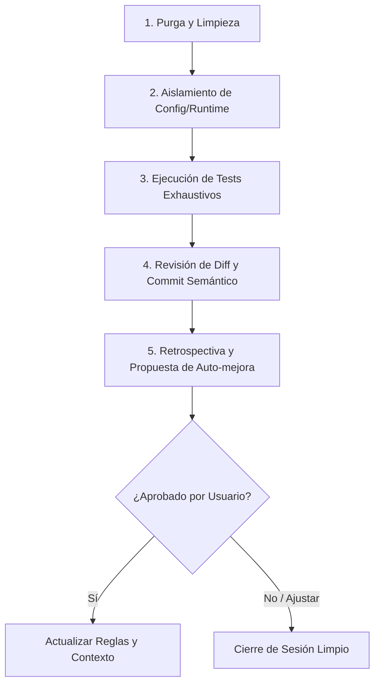

# Regla de Workspace: Protocolo de Cierre, Limpieza y Auto-mejora Continua

Esta regla es de cumplimiento **obligatorio** para todo agente al finalizar una tarea, feature, corrección o proceso de desarrollo en este repositorio.

---

## 1. Política Estricta de Archivos Temporales (`tmp/`)

1. **Ubicación Exclusiva:** Cualquier archivo efímero, vista previa HTML interactiva, mockups A/B, volcados de depuración o scripts de prueba rápidos **DEBEN crearse exclusivamente dentro del directorio `tmp/`** en la raíz del proyecto.
2. **Prohibición en Rutas de Producción:** Queda terminantemente prohibido generar archivos temporales en `ui/`, `assets/`, `tests/` o directamente en la raíz del repositorio.
3. **Ignorado en Git:** El directorio `tmp/` está registrado en `.gitignore` para garantizar que prototipos y archivos de prueba nunca contaminen el historial de commits.

---

## 2. Aislamiento de Runtime y Datos Locales (`config.json`)

1. **Datos de Sesión Excluidos de Git:** El archivo `config.json` almacena rutas absolutas del desarrollador y su historial reciente de conversiones. Está permanentemente ignorado en `.gitignore`.
2. **Plantilla Limpia (`config.template.json`):** Toda configuración estructural o nuevos parámetros deben definirse en `config.template.json` con valores neutros (`root_dir: ""`, etc.).
3. **Comportamiento del Backend:** `app.py` inicializa automáticamente `config.json` copiando desde `config.template.json` si no existe en el sistema anfitrión.

---

## 3. Protocolo de Cierre de Tarea (Los 5 Pasos Obligatorios)

Al terminar cualquier requerimiento o antes de dar por cerrada una sesión:

1. **Paso 1: Purga y Limpieza de Basura:**
   - Verificar `git status`.
   - Limpiar o mover a `tmp/` cualquier archivo residual.
2. **Paso 2: Aislamiento de Configuración:**
   - Confirmar que ningún archivo local (como `config.json`) esté staged para commit.
3. **Paso 3: Validación Doble (Quality Gates):**
   - Ejecutar suite rápida: `python verify_app.py` (9/9 checks).
   - Ejecutar suite integral: `python run_tests.py` (85/85 tests).
   - 100% de éxito requerido antes de hacer commit.
4. **Paso 4: Revisión de Diff y Commit Semántico:**
   - Inspeccionar `git diff --staged`.
   - Realizar commit con formato Conventional Commits (`feat:`, `fix:`, `docs:`, `test:`, `chore:`).
5. **Paso 5: Retrospectiva de Auto-mejora Continua (Obligatoria):**
   - El agente debe hacer un auto-análisis reflexivo de la tarea realizada:
     - ¿Se produjo alguna fricción o paso repetitivo que pueda automatizarse?
     - ¿Se descubrió un nuevo patrón o convención que deba estandarizarse?
     - ¿Hay código, estilos o pruebas que puedan optimizarse a futuro?
   - **Formular propuestas concretas al usuario** al final del turno.
   - Solo tras la confirmación del usuario, plasmar esas mejoras en `.agents/rules/` y `AGENTS.md`.
