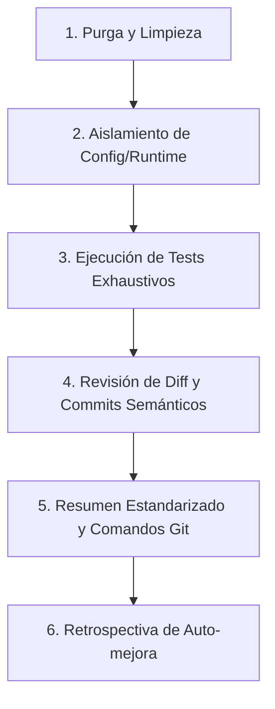

# Regla de Workspace: Protocolo de Cierre, Limpieza y Auto-mejora Continua

Esta regla es de cumplimiento **obligatorio** para todo agente al finalizar una tarea, feature, corrección o proceso de desarrollo en este repositorio.

---

> [!IMPORTANT]
> **ENTREGA OBLIGATORIA DEL FLUJO COMPLETO DE GIT (RAMA, COMMITS, MERGE, PUSH Y CIERRE):**
> Al finalizar cualquier implementación, corrección o ticket, el agente **DEBE SIEMPRE Y SIN EXCEPCIÓN** entregar al final de su respuesta la secuencia completa de comandos Git lista para copiar y ejecutar en un solo bloque. Esta secuencia debe incluir:
> 1. Creación o posicionamiento en la rama de trabajo (`git checkout -b bugfix/<nombre>` o `feature/<nombre>`).
> 2. `git add` y `git commit -m "..."` semánticos y atómicos.
> 3. Cambio a la rama de integración (`git checkout develop` o `master`).
> 4. Merge sin fast-forward: `git merge --no-ff <rama> -m "merge: ..."`
> 5. Publicación en el repositorio remoto: `git push origin <rama_destino>`.
> 6. Cierre y eliminación limpia de la rama local: `git branch -d <rama>`.
> De esta forma, el usuario puede probar la solución y cerrar/enviar el ciclo completo a GitHub en ese mismo momento sin pasos faltantes.

## 1. Política Estricta de Archivos Temporales (`tmp/`)

1. **Ubicación Exclusiva:** Cualquier archivo efímero, vista previa HTML interactiva, mockups A/B, volcados de depuración o scripts de prueba rápidos **DEBEN crearse exclusivamente dentro del directorio `tmp/`** en la raíz del proyecto.
2. **Prohibición en Rutas de Producción:** Queda terminantemente prohibido generar archivos temporales en `ui/`, `assets/`, `tests/` o directamente en la raíz del repositorio.
3. **Ignorado en Git:** El directorio `tmp/` está registrado en `.gitignore` para garantizar que prototipos y archivos de prueba nunca contaminen el historial de commits.

---

## 2. Aislamiento de Runtime y Datos Locales (`config.json`)

1. **Datos de Sesión Excluidos de Git:** El archivo `config.json` almacena rutas absolutas del desarrollador y su historial reciente de conversiones. Está permanentemente ignorado en `.gitignore`.
2. **Plantilla Limpia (`config.template.json`):** Toda configuración estructural o nuevos parámetros deben definirse en `config.template.json` con valores neutros (`root_dir: ""`, etc.).
3. **Comportamiento del Backend:** `app.py` inicializa automáticamente `config.json` copiando desde `config.template.json` si no existe en el sistema anfitrión.

---

## 3. Protocolo de Cierre de Ticket (Los 5 Pasos Obligatorios)

> [!IMPORTANT]
> **Modelo de Trabajo por Tickets:** A partir de ahora, **toda nueva tarea, requerimiento, corrección o mejora solicitada por el usuario es tratada formalmente como un Ticket**. Todo ticket debe concluir obligatoriamente con el **Resumen Estandarizado de Cierre** y los **Comandos Git Estandarizados**.

Al terminar cualquier ticket o antes de dar por cerrada una sesión:

1. **Paso 1: Purga y Limpieza de Basura:**
   - Verificar `git status`.
   - Limpiar o mover a `tmp/` cualquier archivo residual.
2. **Paso 2: Aislamiento de Configuración:**
   - Confirmar que ningún archivo local (como `config.json`) esté staged para commit.
3. **Paso 3: Validación Doble (Quality Gates):**
   - Ejecutar suite rápida: `python verify_app.py` (10/10 checks).
   - Ejecutar suite integral: `python run_tests.py` (100% éxito en todos los tests).
   - 100% de éxito requerido antes de hacer commit.
4. **Paso 4: Revisión de Diff y Commits Semánticos:**
   - Inspeccionar `git diff` y `git status`.
   - Estructurar commits con formato Conventional Commits (`feat:`, `test:`, `docs:`, `fix:`, `chore:`).
5. **Paso 5: Entrega Final Obligatoria (Resumen Estandarizado de Cierre de Ticket):**
   Como último paso de respuesta al usuario, el agente **DEBE SIEMPRE** proporcionar un resumen estandarizado con la siguiente estructura fija:
   - **📋 Resumen de Cambios:** Explicación técnica clara y concisa de las modificaciones realizadas.
   - **✨ Cosas Nuevas Incorporadas:** Nuevos módulos, dependencias offline, sintaxis soportadas o características añadidas.
   - **🧪 Pruebas Existentes Ejecutadas:** Total de pruebas previas verificadas con 100% de éxito (0 regresiones).
   - **🔬 Pruebas Nuevas Añadidas:** Detalle exhaustivo de las nuevas pruebas unitarias/integración creadas para el ticket.
   - **📂 Archivos Modificados y Creados:** Lista de archivos con etiquetas `[NEW]`, `[MODIFY]`, `[DELETE]`.
   - **💻 Comandos Estandarizados de Git:** Bloque de comandos listo para copiar/ejecutar con:
     1. Creación/cambio a rama de feature si aplica (`git checkout -b feature/<nombre>`).
     2. `git add` y `git commit` semánticos atómicos (`feat:`, `test:`, `docs:`).
      3. Retorno a la rama de integración (`git checkout develop` o `git checkout master`).
      4. Fusión formal preservando la historia (`git merge --no-ff <tipo>/<nombre> -m "merge: ..."`).
      5. Publicación remota (`git push origin develop` o `git push origin master`).
      6. Limpieza final de la rama (`git branch -d <tipo>/<nombre>`).
6. **Paso 6: Retrospectiva y Propuesta de Auto-mejora Continua:**
   - **Caso 1: No se identificaron mejoras al contexto:**
     Mencionarlo explícitamente en el resumen final: `🎯 Retrospectiva de Auto-mejora: No se identificaron mejoras para agregar al contexto en este ticket.`
   - **Caso 2: Se identificó una mejora o patrón aplicable al contexto:**
     Aparece únicamente si durante la conversación se descubrió un patrón arquitectónico, solución a bug sutil, lección aprendida o regla a estandarizar que deba persistirse en el contexto (`.agents/AGENTS.md`, `.agents/rules/`, `README.md`, etc.).
     - **Archivo a modificar:** Mencionar la ruta exacta del archivo a actualizar.
     - **Contenido del cambio:** Explicar detalladamente qué sección y qué texto o directriz técnica se modificará o agregará.
     - **Pregunta de confirmación obligatoria:** Formularlo estrictamente como una pregunta. **PROHIBIDO aplicar el cambio de contexto automáticamente.** Solo si el usuario responde con un **"SÍ" explícito**, el agente procederá a aplicar el cambio en el archivo de contexto/regla.
