# Manual de Flujo de Trabajo Git Flow y Ciclo de Vida de Ingeniería

Este documento establece el marco operativo y metodológico oficial para el desarrollo, evolución y mantenimiento de **Markdown to HTML Desktop App**. Su objetivo es normar tanto la interacción consultiva como la ejecución técnica rigurosa de agentes de IA y desarrolladores humanos.

---

## 1. Filosofía de Operación: Doble Modalidad

Para garantizar un balance óptimo entre agilidad analítica y rigurosidad técnica, todo requerimiento del usuario se clasifica inmediatamente en uno de dos modos operativos:

```
                            [ REQUERIMIENTO DEL USUARIO ]
                                         │
                 ┌───────────────────────┴───────────────────────┐
                 ▼                                               ▼
     [ ¿Es consulta o propuesta? ]                 [ ¿Es orden directa de acción? ]
     ("analiza", "quiero ver", "¿podríamos?")      ("hazlo", "implementa", "corrige")
                 │                                               │
                 ▼                                               ▼
    ┌───────────────────────────┐                 ┌───────────────────────────┐
    │     MODO CONSULTIVO       │                 │       FLUJO GRANDE        │
    │   (Proposal & Preview)    │                 │ (Full Engineering Flow)   │
    │                           │                 │                           │
    │ • Análisis técnico        │                 │ 1. Planificar             │
    │ • Mockups y alternativas  │                 │ 2. Ramificar (Git Flow)   │
    │ • Impacto y riesgos       │                 │ 3. Desarrollo cíclico     │
    │ • Cero commits/ramas      │                 │ 4. Testear (100% Pass)    │
    │ • Espera aprobación       │                 │ 5. Sincronizar Context .md│
    └───────────────────────────┘                 │ 6. Merge --no-ff & Prune  │
                 │                                │ 7. Reporte ejecutivo      │
                 └──────────── [ Usuario dice: "Hazlo" ] ─────────┘
```

---

## 2. Modo 1: Propuesta y Evaluación Previa (Proposal & Preview Mode)

### 2.1. Criterios de Activación
Se activa cuando el usuario formula solicitudes como:
- *"Analiza si es viable agregar X"*
- *"Quiero ver primero cómo se resolvería Y antes de aplicarlo"*
- *"¿Podríamos mejorar el diseño de Z? Muéstrame opciones"*
- *"Evalúa el impacto de cambiar tal comportamiento"*

### 2.2. Protocolo de Ejecución del Modo Consultivo
En esta modalidad, **está estrictamente prohibido modificar archivos productivos, crear ramas en Git o realizar commits**. El agente debe:

1. **Investigar y Diagnosticar:**
   - Inspeccionar el código actual (`app.py`, `md_engine.py`, `ui/index.html`, etc.) sin modificarlo.
   - Identificar dependencias internas, riesgos de regresión y puntos de entrada.
2. **Construir la Propuesta de Solución:**
   - **Explicación Arquitectónica:** Cómo encaja con el principio *Zero-Bloatware* (solo biblioteca estándar de Python y Vanilla JS/CSS).
   - **Prototipo / Mockup Visual o de Código:** Snippets de código propuestos, diseño de endpoints o interfaces de usuario simuladas.
   - **Análisis de Pros, Contras y Alternativas:** Comparar al menos dos enfoques técnicos viables.
   - **Estimación de Impacto en Pruebas:** Qué pruebas existentes se verían afectadas y qué nuevas pruebas unitarias se requerirían.
3. **Cierre Consultivo:**
   - Solicitar formalmente confirmación al usuario:  
     *«He formulado la propuesta técnica. Si estás de acuerdo, confírmame para iniciar el **Flujo Grande de Ingeniería** e implementarlo.»*

---

## 3. Modo 2: Flujo Integral de Ejecución ("El Flujo Grande")

### 3.1. Criterios de Activación
Se activa cuando:
- El usuario da una instrucción explícita de acción: *"hazlo"*, *"arréglalo"*, *"implementa X"*, *"corrige el error Y"*.
- El usuario aprueba una propuesta previa presentada en el Modo 1 (*"me gusta la opción A, adelante"*).

### 3.2. Las 7 Fases del Flujo Grande

```mermaid
sequenceDiagram
    autonumber
    actor Usuario
    participant Agente
    participant Git as Git Repo
    participant Code as Base de Código
    participant Tests as Test Runner (run_tests.py)
    participant Context as Archivos de Contexto (.md)

    Usuario->>Agente: Instrucción directa: "Haz la mejora X"
    
    rect rgb(20, 25, 35)
        Note over Agente: Fase 1: Planificación
        Agente->>Agente: Elabora plan estructurado y estrategia TDD
    end

    rect rgb(25, 35, 25)
        Note over Agente, Git: Fase 2: Ramificación Git Flow
        Agente->>Git: git checkout develop
        Agente->>Git: git checkout -b feature/nombre-mejora
    end

    rect rgb(35, 30, 20)
        Note over Agente, Code: Fase 3: Desarrollo Cíclico
        Agente->>Code: Implementación modular limpia (Zero-Bloatware)
    end

    rect rgb(35, 20, 35)
        Note over Agente, Tests: Fase 4: Testing Exhaustivo
        Agente->>Tests: Añade pruebas unitarias en tests/
        Agente->>Tests: Ejecuta run_tests.py (79+ pruebas)
        Tests-->>Agente: 100% Exitoso (Verde)
    end

    rect rgb(20, 35, 35)
        Note over Agente, Context: Fase 5: Actualización de Reglas y Contexto
        Agente->>Context: Plasma nuevas reglas en AGENTS.md, rules/, etc.
    end

    rect rgb(30, 25, 40)
        Note over Agente, Git: Fase 6: Commits Atómicos y Merge
        Agente->>Git: git add & git commit (Conventional Commits)
        Agente->>Git: git checkout develop
        Agente->>Git: git merge --no-ff feature/...
        Agente->>Tests: Revalida suite completa en develop
        Agente->>Git: git branch -d feature/...
    end

    Agente-->>Usuario: Fase 7: Reporte ejecutivo de entrega con evidencias
```



---

### Fase 1: Planificación y Especificación Arquitectónica (Plan)
- **Desglose de Requisitos:** Formular el alcance exacto de la tarea.
- **Análisis de Impacto:** Identificar archivos a modificar (`app.py`, `md_engine.py`, `ui/`, `tests/`).
- **Diseño de Contratos:** Definir firmas de funciones, endpoints REST o eventos del DOM.
- **Estrategia TDD:** Definir los casos de prueba unitarios antes de codificar.

### Fase 2: Ramificación Aislada Obligatoria en Git Flow (Branch Pre-Coding)
> [!CAUTION]
> **REGLA DE ORO:** Queda terminantemente prohibido escribir código o crear archivos directamente en `develop` o `master`. La rama de trabajo debe crearse **ANTES** de iniciar cualquier modificación.

- Comprobar que el espacio de trabajo esté limpio (`git status`).
- Posicionarse en la rama base de integración: `git checkout develop`.
- Crear la rama de trabajo siguiendo la taxonomía:
  - Nueva funcionalidad: `git checkout -b feature/<nombre-descriptivo>`
  - Corrección de bugs: `git checkout -b bugfix/<nombre-descriptivo>`
  - Pruebas o testing: `git checkout -b test/<nombre-descriptivo>`
  - Refactorización: `git checkout -b refactor/<nombre-descriptivo>`

### Fase 3: Desarrollo Cíclico e Incremental (Code)
- Desarrollar en iteraciones modulares y pequeñas.
- Respetar los estándares del proyecto:
  - **Zero-Bloatware:** Prohibido instalar paquetes externos en `pip` o librerías de Node.js.
  - **Compatibilidad con `pythonw.exe`:** Proteger accesos a `sys.stdout`/`sys.stderr`.
  - **Apple OLED Dark Design:** Superficies oscuras, contrastes accesibles y animaciones con física de resorte.

### Fase 4: Aseguramiento de Calidad y Pruebas Unitarias (Test)
- Diseñar e implementar pruebas unitarias que cubran los casos de éxito, casos límite y entradas inválidas en el módulo respectivo dentro de `tests/`.
- Ejecutar la suite integral de verificación:
  ```powershell
  python run_tests.py
  ```
- Ejecutar la suite de humo del servidor:
  ```powershell
  python verify_app.py
  ```
- **Regla Inquebrantable:** El 100% de las pruebas debe pasar (100+ tests en verde). Si una sola prueba falla, se prohíbe avanzar al commit hasta resolverla.

### Fase 5: Sincronización y Evolución de Archivos de Contexto (Context & Rules Evolution)
> [!IMPORTANT]
> **El Conocimiento del Proyecto es un Ente Vivo:** Si la implementación introdujo una nueva decisión arquitectónica, una regla de negocio, un endpoint nuevo o una corrección de seguridad:
- Se debe plasmar inmediatamente en los archivos de contexto:
  - `.agents/AGENTS.md`: Arquitectura, endpoints y especificación técnica.
  - `.agents/rules/*.md`: Reglas activas para futuros agentes.
  - `README.md`: Documentación para el usuario humano.
  - `GIT_FLOW.md`: Si el proceso de ingeniería evolucionó.

### Fase 6: Commits Atómicos Progresivos e Integración Git Flow (Commit & Merge)
- **Commits Atómicos y Granulares:** Prohibido hacer un solo commit masivo con todos los cambios mezclados. Se deben separar por propósito:
  1. `feat(<scope>): ...` para los archivos de funcionalidad o scripts nuevos.
  2. `test(<scope>): ...` para las pruebas unitarias y de integración asociadas.
  3. `docs(<scope>): ...` para README, especificaciones y reglas.
- **Merge sin Fast-Forward:**
  ```powershell
  git checkout develop
  git merge --no-ff feature/<nombre-rama> -m "merge: feature/<nombre-rama> into develop"
  ```
- Re-ejecutar `python run_tests.py` sobre `develop` para certificar que el merge no causó regresiones.
- Eliminar la rama de trabajo local integrada:
  ```powershell
  git branch -d feature/<nombre-rama>
  ```

### Fase 7: Cierre, Demostración Ejecutiva y Comandos de Cierre (Report & Commands)
- **Entrega Inmediata Obligatoria en la Misma Respuesta:** Tan pronto concluyan la implementación y los tests (100% verde), el agente debe entregar el reporte ejecutivo y el bloque completo de comandos Git listo para copiar y ejecutar (rama, commits semánticos, merge `--no-ff` a `develop`, push y prune).
- **Consciencia de Revisión Humana:** El agente proporciona estos comandos sabiendo que el usuario primero probará y revisará la solución. Si todo está correcto, el usuario ejecutará el bloque; si hay errores o ajustes requeridos, no los ejecutará y solicitará correcciones al agente. Queda prohibido obligar al usuario a pedir los commits en un turno posterior.
- Entregar al usuario un informe conciso que incluya:
  - Qué se cambió y por qué.
  - Enlaces clicables a los archivos modificados ([archivo](file:///ruta)).
  - Resultado de las pruebas automatizadas (número de tests pasados).
  - Guía rápida para verificar el cambio en la aplicación real.
  - Bloque completo de comandos Git para cerrar el ticket.

---

## 4. Taxonomía de Ramas

| Rama | Tipo | Origen | Merge Hacia | Ejemplo |
| :--- | :---: | :---: | :---: | :--- |
| **`master`** | Permanente | N/A | N/A | Rama de producción estable. Tags: `v1.0.0` |
| **`develop`** | Permanente | `master` | `master` (vía release) | Rama de integración continua |
| **`feature/*`** | Temporal | `develop` | `develop` | `feature/auto-reload-history` |
| **`bugfix/*`** | Temporal | `develop` | `develop` | `bugfix/fix-ghost-doc-cleanup` |
| **`release/*`** | Temporal | `develop` | `master` y `develop` | `release/v1.1.0` |
| **`hotfix/*`** | Temporal | `master` | `master` y `develop` | `hotfix/v1.0.1` |
| **`test/*`** | Temporal | `develop` | `develop` | `test/add-api-stress-tests` |
| **`docs/*`** | Temporal | `develop` | `develop` | `docs/update-architecture-manual` |

---

## 5. Formato de Conventional Commits

```
<tipo>(<alcance>): <descripción en imperativo y minúsculas>
```

### Tipos Válidos:
- **`feat`**: Nueva funcionalidad para la app o el motor.
- **`fix`**: Corrección de un fallo o error de lógica.
- **`docs`**: Modificaciones exclusivas en documentación.
- **`style`**: Ajustes estéticos de CSS/UI o maquetación.
- **`refactor`**: Reorganización de código sin alterar su comportamiento externo.
- **`perf`**: Mejoras en tiempo de respuesta o uso de memoria.
- **`test`**: Creación o actualización de suites de prueba.
- **`chore`**: Tareas de configuración, scripts o tooling.
- **`merge`**: Registro explícito de integración entre ramas.

### Alcances Recomendados:
- `(server)`: Lógica de `app.py` o endpoints HTTP.
- `(engine)`: Motor de compilación `md_engine.py`.
- `(ui)`: Interfaz SPA `ui/index.html`.
- `(config)`: Persistencia y carga de `config.json`.
- `(tests)`: Suite de pruebas en `tests/`.
- `(docs)`: Manuales y especificaciones.

---

## 6. Procedimiento para Releases y Hotfixes

### 6.1. Ciclo de Release (`release/vX.Y.Z`)
1. Crear rama `release/vX.Y.Z` desde `develop`.
2. Incrementar versión y actualizar changelog en `README.md` y `AGENTS.md`.
3. Ejecutar suite completa `python run_tests.py` y `python verify_app.py`.
4. Mergear a `master`:
   ```powershell
   git checkout master
   git merge --no-ff release/vX.Y.Z -m "merge: release/vX.Y.Z into master"
   git tag -a vX.Y.Z -m "Release vX.Y.Z"
   ```
5. Mergear a `develop`:
   ```powershell
   git checkout develop
   git merge --no-ff release/vX.Y.Z -m "merge: sync release/vX.Y.Z into develop"
   git branch -d release/vX.Y.Z
   ```

### 6.2. Ciclo de Hotfix (`hotfix/vX.Y.Z`)
1. Nace de `master`: `git checkout -b hotfix/vX.Y.Z master`.
2. Aplica parche de seguridad o corrección crítica.
3. Se valida con `python run_tests.py`.
4. Se mergea a `master` con tag `vX.Y.Z` y se propaga a `develop`:
   ```powershell
   git checkout master
   git merge --no-ff hotfix/vX.Y.Z -m "merge: hotfix/vX.Y.Z into master"
   git tag -a vX.Y.Z -m "Hotfix vX.Y.Z"

   git checkout develop
   git merge --no-ff hotfix/vX.Y.Z -m "merge: propagate hotfix/vX.Y.Z into develop"
   git branch -d hotfix/vX.Y.Z
   ```

---

## 7. Catálogo de Reglas y Mejora Continua

Este manual es un instrumento dinámico. Cada vez que el equipo o los agentes identifiquen:
1. Una nueva categoría de pruebas o un caso límite común,
2. Un nuevo patrón de integración de accesos directos o empaquetado,
3. Una refinación en los pasos del ciclo de desarrollo,

**Se debe actualizar este archivo de contexto** en la Fase 5 del Flujo Grande para que la inteligencia colectiva del repositorio crezca permanentemente.
