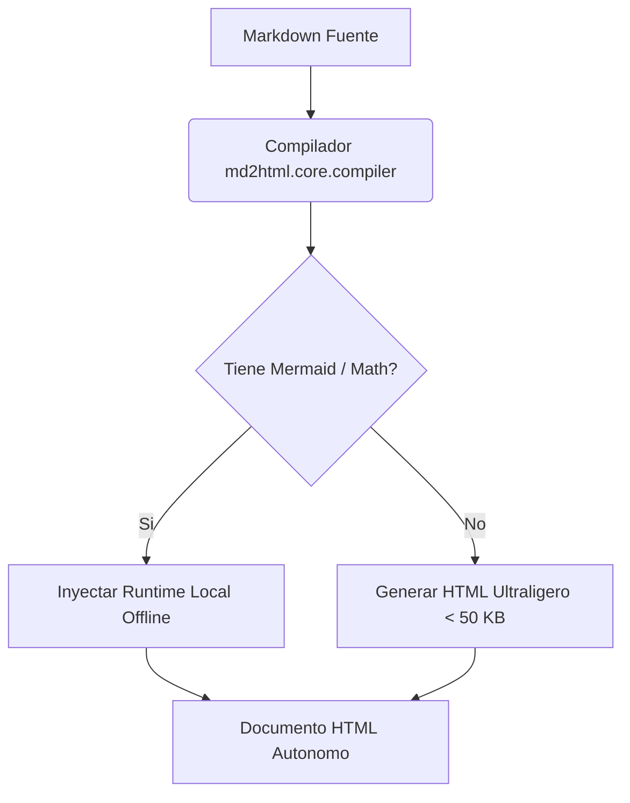

# Markdown to HTML — Desktop Application

[](https://microsoft.com)
[](https://python.org)
[-success)](#arquitectura-tecnica-y-principios-de-diseno)
[-informational)](#estructura-del-proyecto)
[](#pruebas-automatizadas-y-calidad-de-codigo)
[](#integracion-en-el-system-tray-y-guardian-de-instancia-unica)

Aplicacion de escritorio nativa para Windows disenada para la transformacion ultra-rapida (<20 ms) de documentos Markdown a paginas HTML autonomas, responsivas y completamente portables. 

Construida bajo una **Arquitectura Hexagonal Pragmatica (Puertos y Adaptadores)** con una filosofia estricta de **cero dependencias externas (Zero-Bloatware)**, renderizado acelerado por hardware mediante el modo aplicacion de Chromium y una interfaz visual basada en la paleta mate **Ambar Volcanico y Negro Obsidiana (Volcanic Amber & Deep Obsidian)**.

---

## Tabla de Contenidos

- [Vision General y Filosofia de Diseno](#vision-general-y-filosofia-de-diseno)
- [Caracteristicas Principales](#caracteristicas-principales)
- [Requisitos del Sistema](#requisitos-del-sistema)
- [Instalacion y Puesta en Marcha](#instalacion-y-puesta-en-marcha)
  - [Opcion 1: Instalador Rapido de 1 Clic (Recomendado)](#opcion-1-instalador-rapido-de-1-clic-recomendado)
  - [Opcion 2: Ejecucion Portatil (Standalone)](#opcion-2-ejecucion-portatil-standalone)
  - [Opcion 3: Clonacion con Git](#opcion-3-clonacion-con-git)
- [Guia de Migracion y Portabilidad a Otra PC](#guia-de-migracion-y-portabilidad-a-otra-pc)
- [Flujos de Trabajo y Uso](#flujos-de-trabajo-y-uso)
  - [Conversion de Texto y Portapapeles (Zero-Prompts)](#conversion-de-texto-y-portapapeles-zero-prompts)
  - [Conversion desde Archivo (Drag and Drop)](#conversion-desde-archivo-drag-and-drop)
  - [Diagramas Mermaid y Formulas LaTeX 100% Offline](#diagramas-mermaid-y-formulas-latex-100-offline)
  - [Navegacion Cruzada y Biblioteca de Documentos](#navegacion-cruzada-y-biblioteca-de-documentos)
  - [Diagnostico y Visor de Registros](#diagnostico-y-visor-de-registros)
- [Arquitectura Tecnica y Principios de Diseno](#arquitectura-tecnica-y-principios-de-diseno)
  - [Arquitectura Hexagonal (Ports & Adapters)](#arquitectura-hexagonal-ports--adapters)
  - [Filosofia Zero-Bloatware](#filosofia-zero-bloatware)
  - [Modo Aplicacion Chromium](#modo-aplicacion-chromium)
  - [Ciclo de Vida y Watchdog Defensivo](#ciclo-de-vida-y-watchdog-defensivo)
  - [Integracion en el System Tray y Guardian de Instancia Unica](#integracion-en-el-system-tray-y-guardian-de-instancia-unica)
  - [Integracion Win32 para Portapapeles](#integracion-win32-para-portapapeles)
  - [Cache Inteligente contra Bloqueo de Antivirus](#cache-inteligente-contra-bloqueo-de-antivirus)
- [Estructura del Proyecto](#estructura-del-proyecto)
- [Pruebas Automatizadas y Calidad de Codigo](#pruebas-automatizadas-y-calidad-de-codigo)
- [Desinstalacion](#desinstalacion)
- [Estandar de Contribucion y Git Flow](#estandar-de-contribucion-y-git-flow)
- [Licencia](#licencia)

---

## Vision General y Filosofia de Diseno

La mayoria de herramientas contemporaneas para previsualizar y convertir Markdown incorporan entornos pesados basados en Electron o requieren cadenas de herramientas complejas (`npm`, `pip`, compiladores C++ o servicios en la nube). Este proyecto resuelve esa problematica con una arquitectura hibrida minimalista:

1. **Velocidad Extrema (< 20 ms por documento):** El analizador lexico y sintactico procesa el contenido linea por linea en una sola pasada usando expresiones regulares compiladas sobre la biblioteca estandar de Python.
2. **Cero Dependencias de Paquetes (Zero-Bloatware):** No requiere `pip install`, ni entornos virtuales `venv`, ni `node_modules`. Todo el sistema funciona con modulos nativos incluidos en el runtime de Python (`dataclasses`, `typing`, `http.server`, `urllib`, `json`, `ctypes`, `pathlib`, `re`, `socket`, `threading`).
3. **Arquitectura Hexagonal Limpia:** Separacion estricta entre la logica de dominio y compilacion (`md2html/core/`), los adaptadores de infraestructura (`md2html/adapters/` para HTTP, almacenamiento y APIs Win32) y las plantillas desacopladas (`md2html/templates/`).
4. **Ejecucion Nativa y Silenciosa:** Sin consolas negras de terminal visibles para el usuario final gracias a la integracion con `pythonw.exe`.
5. **Documentos Autocontenidos:** Cada archivo HTML generado es 100% independiente; incluye estilos CSS completos, tipografias del sistema, logica interactiva y, cuando corresponde, los runtimes offline de Mermaid y MathJax 3 SVG inyectados directamente. No requiere conexion a internet ni CDNs externos.

---

## Caracteristicas Principales

- **Bandeja del Sistema (System Tray) a 1 Clic:** Acceso instantaneo permanente desde el area de notificacion de Windows junto al reloj. Cierre de ventana optimizado (libera ~150 MB de Edge manteniendo Python en reposo en < 18 MB) y reapertura instantanea en < 200 ms.
- **Menu Contextual y Notificacion en Globo:** Opciones rapidas al dar clic derecho en la bandeja (*Abrir Markdown to HTML*, *Abrir Carpeta de Documentos*, *Ver Biblioteca*, *Salir completamente*) con notificacion informativa nativa de Windows.
- **Entrada Flexible:** Area de edicion con atajos rapidos (`Ctrl + Enter` para convertir, `Ctrl + Shift + V` para pegar y convertir), conteo de palabras y tiempo estimado de lectura en tiempo real.
- **Soporte Drag and Drop:** Arrastre de archivos `.md`, `.markdown` o `.txt` directamente sobre la interfaz o seleccion mediante el explorador nativo de Windows.
- **Acceso Directo al Portapapeles (Zero-Prompts):** Lectura instantanea de memoria via API Win32 a traves del backend, evitando los dialogos invasivos de solicitud de permisos del navegador.
- **Diagramas Mermaid y Formulas Matematicas LaTeX 100% Offline:** Deteccion automatica de bloques ```` ```mermaid ```` y expresiones matematicas LaTeX (`$$...$$`, `$...$`, `\[...\]`, `\(...\)`) con renderizado vectorial SVG autonomo sin requerir internet.
- **Biblioteca Dinamica con Indice Cronologico (`index.html`):** Organizacion automatica de documentos desde el mas nuevo hasta el mas viejo, con buscador reactivo integrado en el cliente.
- **Puntero al Documento Mas Reciente (`latest.html`):** Redireccion automatica y enlace permanente para abrir de inmediato la ultima conversion generada.
- **Navegacion Cruzada Superior:** Todos los documentos generados integran una barra flotante para saltar al indice de documentos, al documento mas reciente o alternar entre tema oscuro y claro.
- **Resaltado de Sintaxis sin Dependencias:** Resaltado integrado para Python, JavaScript, JSON, PowerShell, Groovy, Gherkin y bloques `diff` (adiciones en verde y eliminaciones en rojo).
- **Tipografia y Tablas Responsivas:** Tablas con zebra striping y desplazamiento horizontal automatico, listas jerarquicas anidadas con sangria progresiva y marcadores jerarquicos (`disc` -> `circle` -> `square`).
- **Sistema de Diseno Volcanic Amber & Deep Obsidian:** Superficies de basalto mate (`#070708`, `#111114`, `#17181c`), acentos en ambar volcanico (`#f97316`), tipografia anti-fatiga y curvas de resorte naturales.

---

## Requisitos del Sistema

| Componente | Requisito Minimo | Recomendado | Notas |
| :--- | :--- | :--- | :--- |
| **Sistema Operativo** | Windows 10 (64-bit) | Windows 10 / 11 (64-bit) | Compatible con ediciones Home, Pro y Enterprise |
| **Python** | Python 3.8+ | Python 3.10+ | No requiere permisos de administrador ni `pip` |
| **Navegador** | Microsoft Edge | Microsoft Edge / Chrome | Preinstalado de forma nativa en Windows 10/11 |
| **PowerShell** | PowerShell 5.1+ | PowerShell 5.1+ | Integrado en el sistema operativo |
| **Espacio en Disco** | < 15 MB | < 20 MB | Incluyendo runtimes de Mermaid, MathJax y assets |

---

## Instalacion y Puesta en Marcha

### Opcion 1: Instalador Rapido de 1 Clic (Recomendado)

Disenado para usuarios finales y despliegue rapido en cualquier equipo con Windows:

1. Descarga o descomprime la carpeta del proyecto.
2. Ejecuta con doble clic **`instalar.bat`**.

**Acciones automaticas que realiza el instalador:**
- Verifica la presencia de Python en el sistema. Si no estuviera instalado, ofrece descargarlo e instalarlo automaticamente mediante `winget install -e --id Python.Python.3.12 --scope user`.
- Copia los archivos del programa a la ruta estandar de usuario: `%LOCALAPPDATA%\Programs\MarkdownToHTML_App` (no requiere permisos de Administrador ni dispara advertencias de UAC).
- Ejecuta `install_shortcuts.ps1` con `-ExecutionPolicy Bypass` para registrar accesos directos con el icono oficial (`assets/app_icon.ico`) en:
  - El **Escritorio**: `Markdown to HTML.lnk`
  - El **Menu Inicio**: buscando `Markdown to HTML`
- Configura el inicio silencioso con `pythonw.exe` (sin ventanas de terminal negras).

---

### Opcion 2: Ejecucion Portatil (Standalone)

Si prefieres utilizar la aplicacion sin instalarla en el sistema:

1. Ubica la carpeta `MarkdownToHTML_App` en cualquier unidad o directorio (ej. `C:\Herramientas\`, una memoria USB o tu carpeta de usuario).
2. Haz doble clic en **`launch.vbs`** para abrir la aplicacion de forma completamente silenciosa, o en **`run.bat`** para ejecucion rapida.
3. Si deseas crear los accesos directos apuntando a esa ubicacion fija, ejecuta en una terminal de PowerShell:
   ```powershell
   powershell.exe -ExecutionPolicy Bypass -File .\install_shortcuts.ps1
   ```

---

### Opcion 3: Clonacion con Git

Para desarrolladores o usuarios que mantendran la aplicacion sincronizada con el repositorio:

```powershell
# 1. Clonar el repositorio
git clone <URL_DEL_REPOSITORIO> MarkdownToHTML_App
cd MarkdownToHTML_App

# 2. Registrar accesos directos locales (opcional)
powershell -ExecutionPolicy Bypass -File .\install_shortcuts.ps1

# 3. Iniciar la aplicacion
# Opcion A (Silenciosa en segundo plano):
cscript //nologo launch.vbs

# Opcion B (Desde consola para ver salida de depuracion):
python app.py
```

---

## Guia de Migracion y Portabilidad a Otra PC

La aplicacion fue disenada para funcionar de forma inmediata al transferirse entre computadoras diferentes, sin provocar errores por rutas absolutas o historiales huerfanos.

### Principios de Portabilidad

1. **Resolucion de Rutas Dinamicas:**
   Todo el backend y el motor de compilacion resuelven sus rutas de manera relativa al directorio de ejecucion (`Path(__file__).resolve().parent`). La aplicacion puede ubicarse en cualquier disco o directorio sin alterar su funcionamiento.

2. **Aislamiento de Configuracion Local:**
   - El archivo `config.json` esta registrado en `.gitignore` para no filtrar rutas de desarrollo al repositorio.
   - Si `config.json` no existe al iniciar en una nueva maquina, el backend lo genera automaticamente a partir de `config.template.json`, estableciendo como directorio de salida por defecto la carpeta de descargas del usuario activo:
     ```text
     C:\Users\<UsuarioActual>\Downloads\Markdown_HTML_Library
     ```
   - Si la carpeta destino no existe fisicamente, el sistema la crea de forma segura en la primera ejecucion.

3. **Purga Automatica de Archivos Fantasma:**
   Si se transfiere un archivo `config.json` que contiene un historial de documentos generados en otra maquina, el repositorio de configuracion valida la existencia fisica de cada archivo en disco al arrancar y depura silenciosamente aquellos que no existan, evitando enlaces rotos.

---

## Flujos de Trabajo y Uso

### Conversion de Texto y Portapapeles (Zero-Prompts)

1. **Pegar Contenido:**
   - Haz clic en **Pegar** para colocar el contenido del portapapeles en el area de texto.
   - O haz clic en **Pegar y Convertir** (o presiona `Ctrl + Shift + V`) para realizar ambas acciones en un solo paso.
   - La lectura se ejecuta a nivel de sistema operativo mediante la API Win32 del backend, por lo que el navegador **no mostrara advertencias emergentes solicitando permisos**.
2. **Convertir:**
   - Presiona el boton **Convertir Actual** o utiliza el atajo `Ctrl + Enter`.
3. **Acciones Inmediatas:**
   - **Abrir Documento:** Muestra el archivo generado en tu navegador predeterminado.
   - **Copiar Enlace:** Copia al portapapeles la ruta `file:///...` lista para compartir o archivar.
   - **Abrir Carpeta:** Abre el Explorador de Windows posicionado en la carpeta de la biblioteca.

---

### Conversion desde Archivo (Drag and Drop)

1. Arrastra un archivo `.md`, `.markdown` o `.txt` y sueltalo dentro de la zona delimitada de la interfaz.
2. O haz clic en **Examinar Archivo (.md)** para elegirlo mediante el selector nativo de Windows.
3. Haz clic en **Convertir Actual**.

---

### Diagramas Mermaid y Formulas LaTeX 100% Offline

Puedes incluir cualquier diagrama compatible con Mermaid encerrandolo en bloques de codigo con la etiqueta `mermaid`, asi como expresiones matematicas en bloque (`$$...$$`) o en linea (`$...$`):

````markdown

````

**Funcionalidades integradas:**
- **Tarjeta Responsiva Mermaid:** Cabecera con titulo `DIAGRAMA MERMAID`, visor de codigo fuente interactivo, boton de copiado con confirmacion visual (`✓ Copiado`) y menu **Exportar ▾** para abrir en nueva pestaña o descargar en **SVG** (vectorial infinito), **PNG** (Ultra-HD con escala adaptativa 3x/4x) y **JPG** con fondo solido adaptado al tema.
- **Formulas Matematicas Vectoriales:** Renderizado SVG nitido mediante MathJax 3 offline (`assets/tex-svg.min.js`) adaptable automaticamente al color del texto del tema activo.
- **Optimizacion de Tamano (Zero-Bloat):** Si el documento no incluye diagramas Mermaid ni formulas matematicas, se omiten por completo los bundles JavaScript, preservando archivos ligeros (< 50 KB) y compilaciones en < 20 ms.

---

### Navegacion Cruzada y Biblioteca de Documentos

Cada pagina HTML generada incorpora una barra superior flotante:
- **Indice de Documentos (`./index.html`):** Abre el catalogo general ordenado cronologicamente, con buscador reactivo en vivo por titulo o nombre de archivo.
- **Mas Reciente (`./latest.html`):** Redirecciona instantaneamente al ultimo documento compilado.
- **Tema Claro / Oscuro:** Permite alternar la visualizacion segun las condiciones de iluminacion.

---

### Diagnostico y Visor de Registros

La aplicacion mantiene un registro de operacion defensivo en `debug_log.txt`:
- Puedes presionar el boton de registros en la cabecera de la aplicacion para consultar en pantalla los eventos mas recientes del servidor.
- Haz clic en **Abrir archivo de log** para abrir `debug_log.txt` directamente en el Bloc de notas o editor predeterminado del sistema.

---

## Arquitectura Tecnica y Principios de Diseno

### Arquitectura Hexagonal (Ports & Adapters)

El proyecto aplica **Arquitectura Hexagonal Pragmatica** en el paquete `md2html/`:
1. **Capa de Dominio y Aplicacion (`md2html/core/`):** Contiene los modelos de datos inmutables/tipados (`@dataclass` en `models.py`), las interfaces de puertos (`typing.Protocol` en `ports.py`), el compilador modular (`compiler/`) y los casos de uso (`services/`). No importa `http.server`, `ctypes` ni `tkinter`.
2. **Capa de Adaptadores (`md2html/adapters/`):**
   - `http/`: Enrutador declarativo (`HttpRouter`) y controlador HTTP (`AppRequestHandler`).
   - `storage/`: Repositorio JSON de configuracion (`JsonConfigRepository`), cache de metadatos (`.index_cache.json`) y logger.
   - `os_win32/`: Integracion nativa con Windows mediante `ctypes` (System Tray, portapapeles, mutex de instancia unica, geometria y rastreo de ventana HWND).
3. **Capa de Plantillas (`md2html/templates/`):** Archivos `.html`, `.css` y `.js` puros cargados en memoria RAM con cache para ensamblar documentos compilados sin cadenas gigantes incrustadas en Python.

### Filosofia Zero-Bloatware

A diferencia de las arquitecturas empaquetadas basadas en Electron o frameworks web pesados, esta aplicacion no agrega ninguna capa de abstraccion externa. No utiliza paquetes de terceros: no requiere `pip`, ni `flask`, ni `fastapi`, ni librerias de compilacion externas. Todo el servidor HTTP y el procesador de Markdown operan con modulos nativos del interprete de Python.

### Modo Aplicacion Chromium

La interfaz de usuario se despliega utilizando la instancia de Microsoft Edge (o Google Chrome) ya presente en el sistema operativo mediante el flag:

```cmd
msedge.exe --app="http://127.0.0.1:51870" --window-size=750,680 ...
```

### Ciclo de Vida y Watchdog Defensivo

Para evitar que procesos de Python queden huerfanos en memoria:
- **Deteccion Nativa de Ventana (HWND Win32):** El servidor rastrea continuamente el identificador de ventana del navegador mediante `user32.IsWindow(hwnd)`. Mientras la ventana exista (incluso minimizada o en segundo plano), el servidor permanece activo.
- **Web Worker de Latidos Inmune a Throttling:** Un worker en segundo plano emite peticiones periodicas `POST /api/heartbeat` para evitar que las restricciones de suspension de Chromium detengan la aplicacion.
- **Apagado Limpio y Diferenciado:** Al cerrar la ventana desde la `X`, si el modo bandeja esta activo, el navegador libera los ~150 MB de Chromium pero mantiene el servidor en reposo; si el modo bandeja esta desactivado, programa el apagado ordenado tras 4 segundos de gracia.

### Integracion en el System Tray y Guardian de Instancia Unica

La aplicacion implementa soporte completo para la bandeja del sistema (area de notificacion de Windows junto al reloj):

- **Cero Dependencias Externas (Win32 ctypes):** Control directo mediante `Shell_NotifyIconW` en `shell32.dll` y `user32.dll` sobre un hilo daemon dedicado (`SystemTrayThread`).
- **Ahorro de Memoria y Reapertura Ultrarrapida (< 200 ms):** Al cerrar la ventana con la `X`, Microsoft Edge se cierra (liberando ~150 MB de memoria RAM), mientras `pythonw.exe` permanece en reposo en la bandeja consumiendo apenas ~14 a 18 MB de RAM y 0% de CPU.
- **Guardian de Instancia Unica (*Single Instance Guard*):** Protegido mediante un Named Mutex de Windows (`Local\MarkdownToHTML_App_SingleInstance_Mutex`).

### Integracion Win32 para Portapapeles

El frontend consulta el endpoint `/api/clipboard` y el adaptador `md2html/adapters/os_win32/clipboard.py` utiliza la API Win32 de Windows (`OpenClipboard`, `GetClipboardData` con formato `CF_UNICODETEXT`, `GlobalLock` y `GlobalUnlock` de 64 bits mediante `ctypes`), leyendo el portapapeles en menos de 1 milisegundo sin disparar alertas del navegador.

### Cache Inteligente contra Bloqueo de Antivirus

La aplicacion implementa una cache persistente de metadatos en `.index_cache.json` (`md2html/adapters/storage/index_cache.py`) identificada por `(filename, mtime, size_kb)`, evitando reabrir archivos HTML pesados con scripts embebidos y logrando regeneraciones del indice en < 5 ms.

---

## Estructura del Proyecto

```text
MarkdownToHTML_App/
│
├── app.py                     # Punto de entrada del servidor HTTP y fachada retrocompatible
├── md_engine.py               # Punto de entrada CLI y fachada del motor de compilacion
├── math_engine.py             # Fachada retrocompatible del motor matematico LaTeX
├── tray_manager.py            # Fachada retrocompatible del administrador del System Tray
│
├── md2html/                   # Paquete de Arquitectura Hexagonal (Ports & Adapters)
│   ├── core/                  # Dominio, puertos (Protocol), compilador AST y casos de uso
│   │   ├── models.py          # @dataclass: ParsedDocument, ConversionResult, WindowGeometry
│   │   ├── ports.py           # Contratos de puertos desacoplados
│   │   ├── compiler/          # Analizadores Markdown, AST de listas, inline, titulos y LaTeX
│   │   └── services/          # Servicios de conversion, catalogo y ciclo de vida (watchdog)
│   ├── adapters/              # Adaptadores de infraestructura
│   │   ├── http/              # HttpRouter declarativo y AppRequestHandler
│   │   ├── storage/           # Repositorio config.json, cache .index_cache.json y logger
│   │   └── os_win32/          # Win32 ctypes: System Tray, portapapeles, mutex, HWND y dialogos
│   └── templates/             # Plantillas HTML, hojas CSS y controladores JS de documentos
│
├── ui/                        # Interfaz grafica SPA modular (Volcanic Amber & Deep Obsidian)
│   ├── index.html             # Estructura semantica HTML5
│   ├── styles.css             # Tokens y estilos CSS3
│   └── app.js                 # Logica cliente, atajos y Web Worker de latidos
│
├── tests/                     # Suite modular de pruebas con unittest nativo (140 tests)
│   ├── __init__.py
│   ├── test_helpers.py
│   ├── test_md_engine.py      # 68 tests: AST, llamadas, tablas, kbd, listas, mermaid, latex, cache
│   ├── test_app_api.py        # 27 tests: Endpoints REST, router, modelos, UI modular, tray, portapapeles
│   ├── test_tray_manager.py   # 6 tests: Estructuras Win32, ciclo de vida del hilo, menus y globo
│   ├── test_window_geometry.py# 7 tests: Dimensionamiento responsivo de ventana
│   ├── test_config_and_history.py # 9 tests: Persistencia, limites y purga de fantasmas
│   ├── test_installer_and_distribution.py # 15 tests: Integridad de instalador y accesos directos
│   └── test_security.py       # 5 tests: Defensa contra Path Traversal, proteccion y XSS
│
├── assets/
│   ├── app_icon.ico           # Icono nativo multirresolucion para Windows (256x256)
│   ├── app_icon.png           # Isotipo oficial en alta resolucion
│   ├── mermaid.min.js         # Runtime embebido offline de Mermaid (Mermaid 11.x)
│   ├── tex-svg.min.js         # Runtime vectorial SVG de MathJax 3 (100% offline)
│   └── generate_icon.ps1      # Generador vectorial del icono mediante System.Drawing
│
├── config.template.json       # Plantilla limpia de configuracion rastreada en Git
├── config.json                # Configuracion local persistente (aislada en .gitignore)
├── instalar.bat               # Instalador rapido de 1 clic para Windows (%LOCALAPPDATA%)
├── desinstalar.bat            # Desinstalador limpio de accesos directos y archivos
├── install_shortcuts.ps1      # Generador y eliminador de accesos directos de Windows
├── launch.vbs                 # Lanzador silencioso en VBScript (sin consola negra)
├── run.bat                    # Lanzador rapido por lotes
├── run_tests.py               # Ejecutor maestro de la suite integral de pruebas (140 tests)
├── verify_app.py              # Suite rapida de verificacion de humo (10 checks)
├── README.md                  # Manual tecnico y documentacion del proyecto
└── GIT_FLOW.md                # Estandar formal de ramas Git Flow y ciclo de ingenieria
```

---

## Pruebas Automatizadas y Calidad de Codigo

El proyecto cuenta con una suite integral de **140 pruebas automatizadas** que validan la funcionalidad del compilador, la arquitectura hexagonal, la API REST, la seguridad, la persistencia, la bandeja del sistema, la geometria de pantalla y la distribucion del instalador:

```powershell
# Ejecutar suite integral completa (140 tests con metricas detalladas):
python run_tests.py

# O ejecutar verificacion rapida de humo (10 checks):
python verify_app.py
```

---

## Desinstalacion

Si en algun momento deseas remover la aplicacion del sistema:

1. Ejecuta **`desinstalar.bat`** (disponible en la carpeta de instalacion o en el repositorio clonado).
2. El script eliminara automaticamente:
   - Los accesos directos del **Escritorio** y del **Menu Inicio**.
   - Los archivos de la aplicacion en `%LOCALAPPDATA%\Programs\MarkdownToHTML_App`.
3. **Nota de Seguridad:** Tus documentos HTML compilados en tu carpeta de biblioteca **nunca seran eliminados**.

---

## Estandar de Contribucion y Git Flow

El desarrollo de este proyecto se rige estrictamente por el estandar **Git Flow** y la especificacion **Conventional Commits**:

- Consulta la guia completa de ciclo de vida en [GIT_FLOW.md](file:///c:/General/MarkdownToHTML_App/GIT_FLOW.md).
- **Requisito de Integracion:** Toda contribucion debe contar con cobertura de pruebas y alcanzar el **100% de exito (0 fallos)** en `run_tests.py` antes de fusionarse.

---

## Licencia

Este proyecto se distribuye bajo la licencia **MIT**. Consulta el archivo `LICENSE` para mas detalles.
